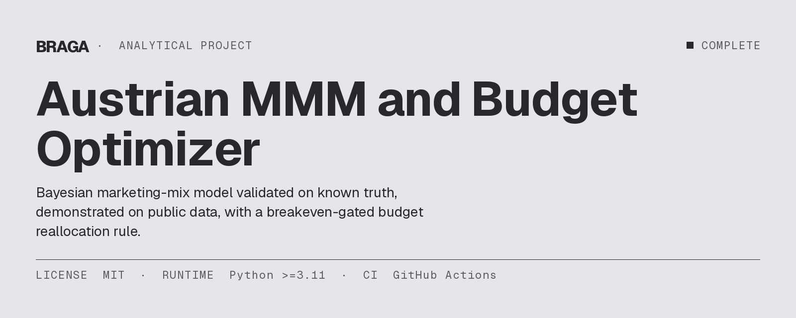
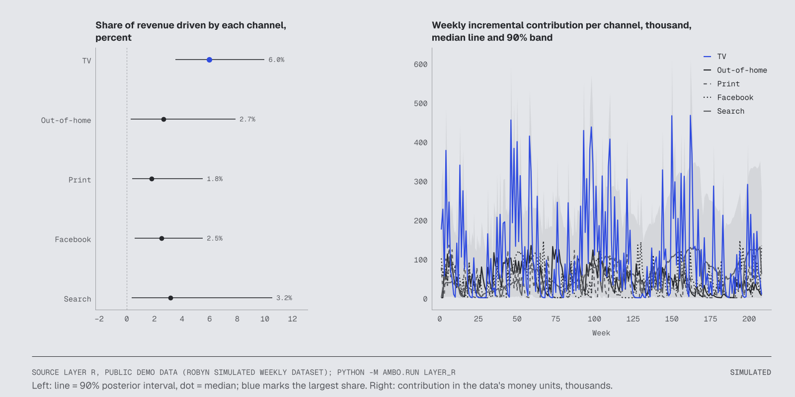
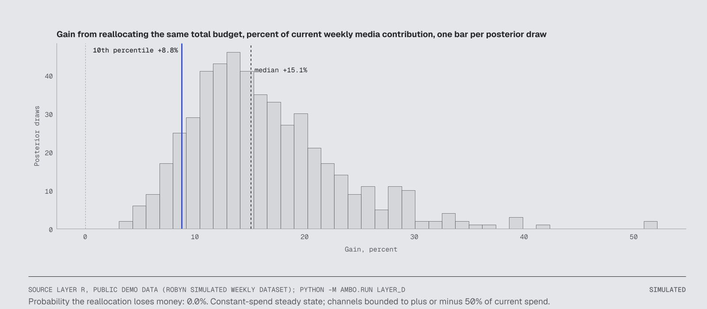
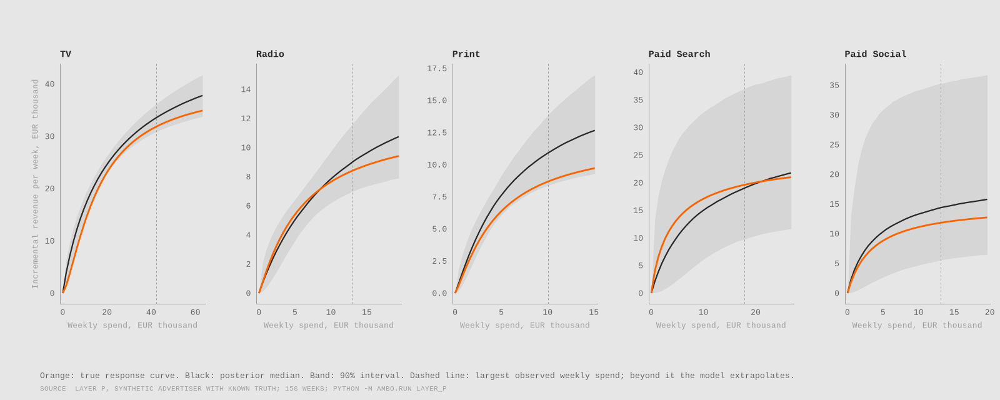
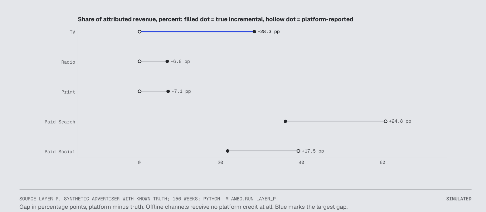
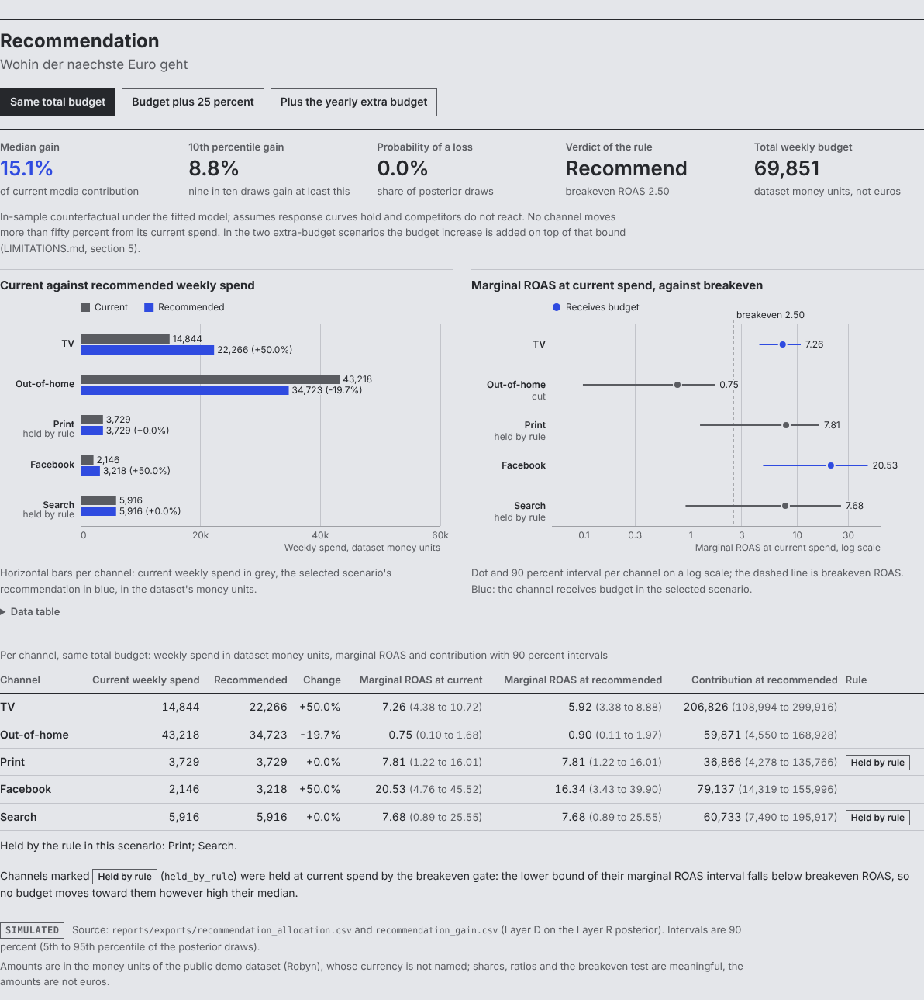
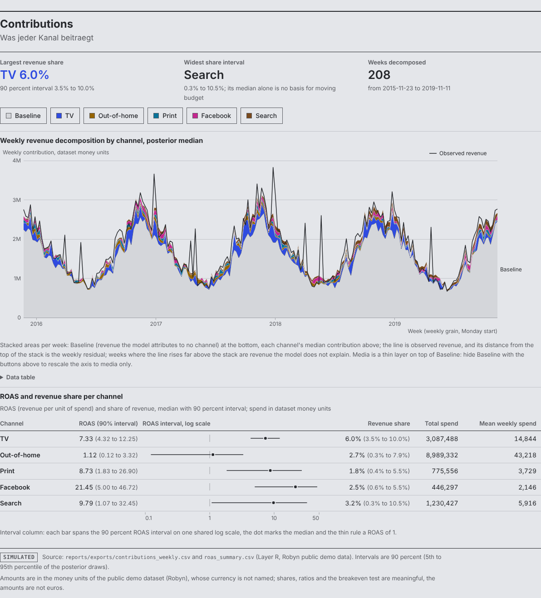
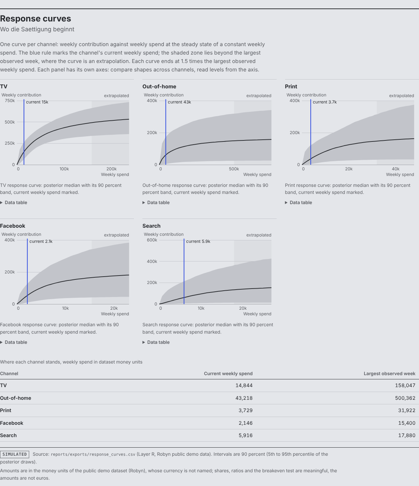
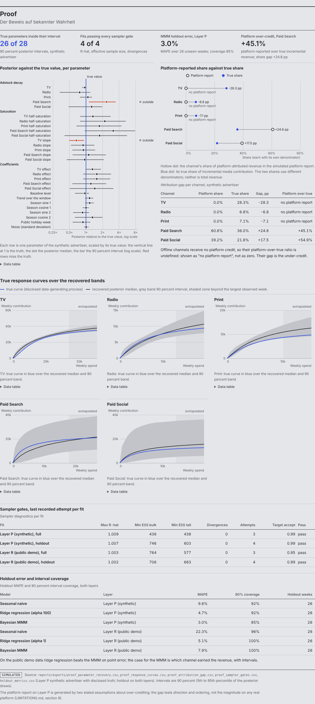
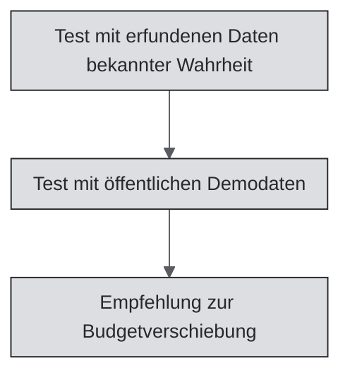

[🇧🇷 PT-BR](README.pt-BR.md) · [🇬🇧 EN-UK](README.md) · [🇦🇹 DE-AT](README.de-AT.md)

# Österreichisches MMM und Budgetoptimierung



[](LICENSE)
[](pyproject.toml)
[](https://github.com/RafaelBraga-Kribitz/austrian-mmm-budget-optimizer/actions)
[](#status)

**Status:** Abgeschlossen

- **Wer entscheidet:** die Marketingleitung oder der CFO.
- **Was entschieden wird:** wohin der nächste Euro des Medienbudgets fließt.
- **Ergebnis:** Das wöchentliche Budget wird aus Out-of-Home (-20 %) in TV und Facebook (jeweils +50 %) verschoben. Der Median des Medienbeitrags steigt um 15,1 %. Die Beträge sind nicht in Euro angegeben.
- **Wichtigster Vorbehalt:** Die Zahlen stammen aus einem öffentlichen Demo-Datensatz, nicht aus österreichischen Kundendaten; die Demo-Beträge sind keine Euro.
- **Diagramm:** der Umsatzanteil, den jeder Kanal erzielt, siehe unten.



*Links: Umsatzanteil je Kanal, Median und 90-%-Intervall. TV erzielt mit 6,0 % den größten Anteil (3,5 bis 10,0). Search hat das breiteste Intervall (0,3 bis 10,5 %); sein Median allein rechtfertigt daher keine Budgetverschiebung. Rechts: wöchentlicher Beitrag jedes Kanals über 208 Wochen, in den Geldeinheiten des Demo-Datensatzes. Die Beträge sind keine Euro.*

## Was das Modell leistet

Ein Marketing-Mix-Modell (MMM) zerlegt den wöchentlichen Umsatz in eine Basis und den Anteil, den jeder Marketingkanal verursacht hat. Dieses Repository erstellt ein Modell für einen einzelnen Werbetreibenden.

Das Modell ist bayesianisch. Jede Schätzung enthält ein 90-%-Intervall statt nur einer Zahl.

Das Modell beantwortet drei Fragen: Welche Kanäle haben inkrementell zum Umsatz beigetragen? Wie stark weichen die von Plattformen gemeldeten Zahlen ab? Welchen Zugewinn bringt eine Umverteilung desselben Budgets?

Inkrementeller Umsatz ist Umsatz, der ohne die Ausgaben für den Kanal nicht entstanden wäre. Drei Schritte bilden die Antwort:

1. Der Test mit erfundenen Daten und bekannter Antwort prüft, ob das Modell eine vorgegebene Wahrheit wiederfindet.
2. Der Test mit öffentlichen Demodaten passt das Modell an einen öffentlichen Datensatz an.
3. Die Budgetverschiebungsempfehlung übersetzt den Fit anhand einer Break-even-Regel in eine Entscheidung.

**Welche Kanäle haben beigetragen?** In den öffentlichen Demodaten beträgt der Umsatzanteil der einzelnen Kanäle:

| Kanal | Umsatzanteil (Prozent) | 90-%-Intervall |
|---|---|---|
| TV | 6.0 | 3.5 bis 10.0 |
| Out-of-Home | 2.7 | 0.3 bis 7.9 |
| Print | 1.8 | 0.4 bis 5.5 |
| Facebook | 2.5 | 0.6 bis 5.5 |
| Search | 3.2 | 0.3 bis 10.5 |

**Wie stark lag der Plattformbericht daneben?** Bei den erfundenen Daten mit bekannter Wahrheit schreibt der Plattformbericht Paid Search 45 % mehr Umsatz gut, als der Kanal tatsächlich zusätzlich erzielt. Offline-Kanäle erhalten keine Gutschrift.

**Findet das Modell die Wahrheit wieder?** Bei diesen erfundenen Daten decken die geschätzten Wirkungskurven die tatsächlichen Kurven über 91 % des beobachteten Ausgabenbereichs ab. Eine Wirkungskurve zeigt den zusätzlichen Umsatz eines Kanals je wöchentlicher Ausgabenhöhe. 26 von 28 tatsächlichen Parametern liegen in ihren 90-%-Intervallen.

**Welchen Zugewinn bringt eine Umverteilung?** Bei den öffentlichen Demodaten beträgt der Median des Zugewinns bei unverändertem Gesamtbudget 15,1 % des aktuellen Medienbeitrags. Die Empfehlung steht im Abschnitt Entscheidung. Die Beträge sind nicht in Euro angegeben.

„Österreichisch“ bezeichnet den Kontext, für den das Modell ausgelegt ist, nicht die verwendeten Daten. Der Kontext umfasst den österreichischen Feiertagskalender als Kontrollvariable, eine wöchentliche Granularität sowie eine Euro- und Deckungsbeitragslogik für einen österreichischen Werbetreibenden. Das Modell wird mit erfundenen Daten bekannter Wahrheit validiert und mit öffentlichen Daten demonstriert; ein Austausch gegen Kundendaten steht noch aus. Österreichische Kundendaten wurden nicht verwendet.

## Warum es dieses Projekt gibt

Plattform-Dashboards schreiben ihren eigenen Kanälen zu viel Umsatz gut. Daher sieht ein Werbetreibender nicht, wohin der nächste Euro des Medienbudgets fließen sollte. Dieses Projekt sollte der Marketingleitung eines großen österreichischen Werbetreibenden zeigen, wie sich dasselbe Budget mit einem intern entwickelten Modell verteilen lässt. Die Bewertung vor dem Bau erwartete über drei jährliche Budgetentscheidungen rund €80.000 Entscheidungsnutzen bei zentralen Kosten von etwa €14.000. Das ist fast das Sechsfache der Kosten und erfüllt unter den getroffenen Annahmen die finanzielle Hürde von Faktor 4. Beobachtetes Ergebnis: noch nicht gemessen. Details: [wirtschaftliche Bewertung](docs/economic-evaluation.md).

## Hier starten

| Zielgruppe | Einstieg |
|---|---|
| Recruiter | [Entscheidung](#entscheidung), erstes Diagramm und [Dashboard](#dashboard) |
| Hiring Manager | [Entscheidung](#entscheidung), [So funktioniert es](#so-funktioniert-es) und [Validierung](#validierung) |
| Technische Reviewer | [So greifen die Teile ineinander](#so-greifen-die-teile-ineinander), [Ausführen](#ausführen) und `src/ambo/` |
| Auditoren | [Daten](#daten), [Validierung](#validierung) und [Bekannte Einschränkungen](#bekannte-einschränkungen) |

## Entscheidung

**Empfehlung (öffentliche Demodaten, gleiches Gesamtbudget):** Das Wochenbudget aus Out-of-Home in TV und Facebook verschieben. Out-of-Home erzielt je zusätzlicher Ausgabeneinheit eine Rendite von 0,75. Das liegt unter der Break-even-Rendite von 2,50; daher wird das Budget um 20 % gekürzt. TV und Facebook erhalten jeweils 50 % mehr.

Print und Search bleiben unverändert. Die Untergrenze ihres Renditeintervalls liegt unter dem Break-even-Return on Ad Spend (ROAS). TV und Facebook erreichen die in der Konfiguration festgelegte Obergrenze für Budgetverschiebungen: jeweils 50 % ihrer aktuellen Ausgaben.

Der erwartete Zugewinn beträgt im Median 15,1 % des aktuellen Medienbeitrags. Das 10. Perzentil beträgt 8,8 %. In 500 posterioren Ziehungen liegt die Verlustwahrscheinlichkeit bei 0,0 %. Da die Beträge nicht in Euro angegeben sind, wird die Empfehlung in Prozent formuliert.

Eine posteriore Ziehung ist ein plausibler Satz von Modellwerten, der zu den Daten passt. In neun von zehn Ziehungen beträgt der Zugewinn mindestens so viel wie das 10. Perzentil.

Return on Ad Spend (ROAS) ist Umsatz je Ausgabeneinheit. Der marginale ROAS ist der Umsatz, den die nächste Ausgabeneinheit erzielt. Ausgaben und Beitrag sind wöchentlich und in den Geldeinheiten des Datensatzes angegeben; diese sind keine Euro.

| Kanal | Aktuelle wöchentliche Ausgaben | Empfohlene wöchentliche Ausgaben | Änderung | Rendite der nächsten Ausgabeneinheit, aktuell (90-%-Intervall) | Rendite der nächsten Ausgabeneinheit nach der Verschiebung (90-%-Intervall) | Medienbeitrag nach der Verschiebung (90-%-Intervall) |
|---|---|---|---|---|---|---|
| TV | 14844 | 22266 | +50 % | 7.26 (4.38 bis 10.72) | 5.92 (3.38 bis 8.88) | 206826 (108994 bis 299916) |
| Out-of-Home | 43218 | 34723 | -20 % | 0.75 (0.10 bis 1.68) | 0.90 (0.11 bis 1.97) | 59871 (4550 bis 168928) |
| Print (durch die Regel gehalten) | 3729 | 3729 | +0 % | 7.81 (1.22 bis 16.01) | 7.81 (1.22 bis 16.01) | 36866 (4278 bis 135766) |
| Facebook | 2146 | 3218 | +50 % | 20.53 (4.76 bis 45.52) | 16.34 (3.43 bis 39.90) | 79137 (14319 bis 155996) |
| Search (durch die Regel gehalten) | 5916 | 5916 | +0 % | 7.68 (0.89 bis 25.55) | 7.68 (0.89 bis 25.55) | 60733 (7490 bis 195917) |

Alle Beträge in der Tabelle sind in den Geldeinheiten der Demodatei angegeben. Sie sind keine Euro.

Zugewinn aus der Umverteilung: Median 15,1 % des aktuellen Medienbeitrags, 10. Perzentil 8,8 %, Verlustwahrscheinlichkeit 0,0 %. Die Beträge sind keine Euro. Die Regel empfiehlt die Verschiebung.

Entscheidungsregel: Budget wird nur so lange zu einem Kanal verschoben, wie die Untergrenze seines marginalen ROAS-90-%-Intervalls über dem Break-even-ROAS liegt. Zusätzlich muss das 10. Perzentil des Umverteilungsgewinns positiv sein.

Der Break-even-ROAS beträgt bei einer Deckungsbeitragsmarge von 40 % den Wert 2,50. Die Konfiguration enthält diese Marge als Annahme. Die Break-even-Schranke lässt Print und Search bei den aktuellen Ausgaben. Die Untergrenze ihres marginalen ROAS-Intervalls liegt unter Break-even. Daher erhalten sie kein zusätzliches Budget, auch wenn ihr Median hoch ist.

Bei zusätzlichen 200.000 pro Jahr, verteilt über 52 Wochen, steigt der Medienbeitrag im Median um 17,4 % (10. Perzentil: 10,6 %). Die Beträge sind in den Geldeinheiten des Datensatzes angegeben und keine Euro. Die Regel empfiehlt die Erhöhung. `reports/layer_d/next_200k.md` zeigt kanalweise, wohin das zusätzliche Budget fließt und wie wahrscheinlich diese Entscheidung falsch ist.



*Zugewinn durch die Verschiebung desselben Budgets, ein Balken je posteriorer Ziehung. Keine der 500 Ziehungen zeigt einen Verlust. Die blaue Linie markiert das 10. Perzentil (8,8 %). Die gestrichelte Linie markiert den Median (15,1 %). Die Beträge sind keine Euro.*

Diese Empfehlung sollte überprüft werden, wenn die tatsächliche Deckungsbeitragsmarge niedriger ist als angenommen. Der Break-even-ROAS ist 1 geteilt durch die Marge. Eine niedrigere Marge erhöht daher die Schwelle, die jeder Kanal überschreiten muss. Dadurch kann die Schranke für einen Kanal geschlossen werden, dessen Budget nach der aktuellen Regel steigen dürfte.

Auch ein Lift-Test, dessen gemessener inkrementeller Effekt außerhalb des Modellintervalls für einen Kanal liegt, wäre ein Grund zur Überprüfung. Ein Lift-Test ist ein Geo-Experiment oder ein Holdout eines Kanals.

## Ergebnisse

Jedes Modell lernt aus den früheren Wochen und prognostiziert die letzten, bisher ungesehenen Wochen. Der Fehler ist der mittlere absolute prozentuale Fehler (MAPE). Die Abdeckung gibt an, wie oft die tatsächliche Woche im 90-%-Intervall des Modells lag.

Zwei einfache Baselines setzen den Vergleichsmaßstab. Seasonal Naive wiederholt den Umsatz von 52 Wochen zuvor. Ridge-Regression ist eine einfache Regression mit einer Strafe für große Koeffizienten.

### Test mit erfundenen Daten bekannter Wahrheit: Das MMM hat den niedrigsten Holdout-Fehler — 3,0 % gegenüber 4,7 % bei Ridge-Regression

Holdout von 26 Wochen mit erfundenen Daten:

| Modell | MAPE | Abdeckung des 90-%-Intervalls |
|---|---|---|
| Seasonal Naive | 9.6 % | 92 % |
| Ridge-Regression | 4.7 % | 92 % |
| Bayesianisches MMM | 3.0 % | 85 % |

Das MMM hat hier den niedrigsten Punktfehler. Seine Begründung beruht nicht darauf, denn die Baselines sagen nicht, welcher Kanal den Umsatz erzielt hat. Die 90-%-Intervalle deckten 85 % der Holdout-Wochen ab, fünf Prozentpunkte weniger als nominell erwartet. Die Intervalle sind daher etwas zu eng und das Modell ist geringfügig zu selbstsicher. Die breiteren Intervalle der Baselines deckten mehr Wochen ab.

### Test mit öffentlichen Demodaten: Ridge-Regression schlägt das MMM beim Holdout-Fehler — 5,1 % gegenüber 7,9 %

Holdout von 26 Wochen mit öffentlichen Demodaten:

| Modell | MAPE | Abdeckung des 90-%-Intervalls |
|---|---|---|
| Seasonal Naive | 22.3 % | 96 % |
| Ridge-Regression | 5.1 % | 100 % |
| Bayesianisches MMM | 7.9 % | 100 % |

Bei diesen Daten ist das MMM beim Punktfehler schlechter als die Ridge-Regression-Baseline. Das Ergebnis wird unverändert berichtet. Die Stärke des MMM ist Interpretierbarkeit, nicht stets höhere Genauigkeit: Es zeigt mit Intervallen, welcher Kanal den Umsatz erzielt hat. Seine 90-%-Intervalle deckten 100 % der Holdout-Wochen ab und damit mehr als die nominellen 90 %. Bei diesen Daten sind die Intervalle also breiter als nötig.

## Validierung



*Blau: tatsächliche Wirkungskurve. Schwarz: posteriorer Median. Band: 90-%-Intervall. Gestrichelte Linie: höchste beobachtete Wochenausgabe. Darüber extrapoliert das Modell.*

Bevor das Modell mit Werbetreibendendaten verwendet werden kann, muss es eine vorgegebene Wahrheit wiederfinden. Beim erfundenen Werbetreibenden decken die geschätzten Wirkungskurven die tatsächlichen Kurven an 91 % der Gitterpunkte innerhalb des beobachteten Ausgabenbereichs ab. Der schwächste Kanal ist TV mit 56 %. Der mittlere Fehler erreicht höchstens 13,7 % der Höhe der tatsächlichen Kurve. 26 von 28 Einzelparametern liegen innerhalb ihrer 90-%-Intervalle.

Die Abweichungen folgen einem bekannten Zielkonflikt und sind kein Fehler. Jede Kurve enthält zwei Einstellungen, die sich gegenseitig ausgleichen: wie hoch sie steigt (Effektgröße) und wie viel Budget sie benötigt, um sich abzuflachen (Halbsättigungspunkt; [So funktioniert es](#so-funktioniert-es) definiert Sättigung). Eine höher steigende Kurve, die sich später abflacht, kann dieselben beobachteten Wochen erklären.

Aus diesem Grund liegen die Medianwerte aller 5 Effektgrößen und aller 5 Halbsättigungspunkte über der Wahrheit. Die Wiederherstellung bewerten wir anhand der Kurven und Anteile, die in der Budgetentscheidung verwendet werden, nicht anhand einzelner Punktparameter.

Die Umsatzanteile werden für 4 von 5 Kanälen abgedeckt. Die Ausnahme liegt knapp außerhalb des Intervalls: TV, der Kanal mit den höchsten Ausgaben. Sein tatsächlicher Anteil beträgt 9,5 %, gegenüber einem Intervall von 9,7 bis 11,4.



*Offener Punkt: Umsatzanteil, den der Plattformbericht einem Kanal zuschreibt. Gefüllter Punkt: tatsächlicher Anteil des inkrementellen Medienbeitrags. Beide beziehen sich auf den erfundenen Werbetreibenden. Die Anteile haben unterschiedliche Nenner und keiner entspricht dem Gesamtumsatz. Der Bericht überschätzt Paid Search um 24,8 und Paid Social um 17,5 Prozentpunkte. Offline-Kanäle erhalten keinen Anteil, obwohl ihre tatsächlichen Anteile TV 28,3 %, Print 7,1 % und Radio 6,8 % betragen.*

Der Abschnitt Ergebnisse zeigt den Holdout-MAPE und die Intervallabdeckung im Vergleich zu zwei Baselines. Der Code speichert die Sampler-Prüfungen neben jedem Fit in `diagnostics.json`.

## Dashboard

Vier Seiten zeigen die CSV-Daten aus `reports/exports/`. Das Dashboard wird aus denselben Dateien auf zwei Arten erstellt. Der erste Build ist ein Power-BI-Projekt (`dashboards/MMM.pbip`): Modell und Bericht bleiben als Textdateien (TMDL und PBIR) erhalten, sodass ein Test jede Visualisierung mit dem Modell abgleicht. Der zweite Build ist ein statischer HTML-Zwilling (`dashboards/html/index.html`): eine einzelne Datei, die offline funktioniert.

Die Screenshots unten zeigen den HTML-Zwilling. Power-BI-Screenshots folgen nach dem Desktop-Schritt in [dashboards/README.md](dashboards/README.md). Die Seitenspezifikation steht unter [docs/dashboard_handoff.md](docs/dashboard_handoff.md). Die Untertitel der Seiten sind auf Deutsch.



*Empfehlungsseite: wohin der nächste Euro fließt. Szenario wählen, Zugewinn und Ergebnis der Regel ablesen und sehen, welche Kanäle mehr Budget erhalten und welche durch die Break-even-Schranke gehalten werden. Die Beträge sind keine Euro.*



*Beitragsseite: der Beitrag jedes Kanals. Sie zeigt die wöchentliche Zerlegung mit dem beobachteten Umsatz oben sowie ROAS und Umsatzanteil je Kanal samt Intervallen. Die Beträge sind keine Euro.*



*Wirkungskurvenseite: wo jeder Kanal abflacht. Sie zeigt die aktuelle Position jedes Kanals auf seiner Kurve und außerdem, ab wann die Kurve den beobachteten Ausgabenbereich verlässt.*



*Nachweisseite: der Test mit bekannter Wahrheit. Sie zeigt dasselbe Modell für den erfundenen Werbetreibenden im Vergleich mit der offengelegten Wahrheit.*

## Daten

Wöchentliche Ausgaben je Kanal und Umsatz. Österreichische Kundendaten wurden nicht verwendet.

| Test | Quelle | Granularität und Zeitraum | Kennzeichnung |
|---|---|---|---|
| Erfundenen Daten mit bekannter Antwort | Generierter Werbetreibender; tatsächliche Parameter in `data/synthetic/truth.json` | Wöchentlich, 156 Wochen, fünf Kanäle (TV, Radio, Print, Paid Search, Paid Social) | `SIMULATED` |
| Öffentliche Demodaten | Simulierter Wochendatensatz von Robyn (MIT, Meta Platforms); Spalten und Lizenz unter `data/README.md` | Wöchentlich, 208 Wochen, fünf benannte Kanäle in den Geldeinheiten der Datei | `SIMULATED` |
| Kontrolle, erfundene Daten | Wochenindikator für österreichische Feiertage | Wöchentlich | `VERIFIED` |
| Annahme | Deckungsbeitragsmarge 40 %, Break-even-ROAS 2,50, Platzhalter in der Public-Demo-Konfiguration bis eine Kundenmarge vorliegt | Entscheidungsregel | `ASSUMPTION` |

Die Beträge in den öffentlichen Demodaten sind keine Euro. Anteile, ROAS-Verhältnisse und der Break-even-Test bleiben aussagekräftig. Die Beträge nicht. Ein Austausch gegen Echtdaten ist vorgesehen.

## Bekannte Einschränkungen

- Die öffentlichen Demodaten sind der simulierte Wochendatensatz von Robyn. Er enthält fünf benannte Kanäle und Umsatz in Geldeinheiten, deren Währung die Autoren nicht nennen. Anteile, ROAS-Verhältnisse und der Break-even-Test sind aussagekräftig; die Beträge sind keine Euro. Österreichische Kundendaten wurden nicht verwendet. Ein Austausch gegen Echtdaten ist vorgesehen.
- Das Modell nimmt eine einzige Form an: geometrisch abklingender Carry-over (Adstock), eine Hill-Sättigungskurve und eine additive Basis. [So funktioniert es](#so-funktioniert-es) erklärt diese Begriffe. Der Test mit erfundenen Daten zeigt, dass der Sampler diese Form wiederherstellt. Er zeigt nicht, dass die Realität dieser Form folgt.
- Effektgröße und Halbsättigungspunkt gleichen sich gegenseitig aus. Daher stellt das Modell einzelne Punktparameter weniger genau wieder her als Kurven und Anteile. Der Abschnitt Validierung beschreibt die Richtung dieser Verzerrung.
- Nationale Wochendaten können Kanäle, deren Ausgaben sich gemeinsam verändern, nicht voneinander trennen. Die Intervalle werden entsprechend breiter. Der Optimierer bleibt innerhalb der in der Konfiguration festgelegten Grenzen.
- Der Optimierer nimmt an, dass Wirkungskurven bei neuen Ausgabenniveaus gelten, Wettbewerber nicht reagieren und konstante Wochenausgaben den stationären Zustand erreichen.

[`LIMITATIONS.md`](LIMITATIONS.md) listet alle Einschränkungen und ihre Bedeutung für ein Kundenprojekt. Die Bauentscheidungen stehen unter [docs/adr/](docs/adr/README.md). Die Dashboard-Spezifikation ist unter [docs/dashboard_handoff.md](docs/dashboard_handoff.md), der Build unter [dashboards/README.md](dashboards/README.md) dokumentiert.

## Was ich mit Produktionsdaten anders machen würde

- Wöchentliche Daten auf regionaler Ebene, damit regionale Schwankungen der Ausgaben die Wirkungskurven identifizieren und nicht nur der Zeitverlauf.
- Kalibrierung anhand von Lift-Tests: Geo-Experimente oder Holdouts für mindestens einen Kanal, als Priors oder zur Prüfung inkrementeller Schätzungen.
- Inflation der Medienkosten, damit sich Ausgaben vor der Modellierung in Reichweite umrechnen lassen und ein Preisanstieg nicht wie Sättigung erscheint.
- Wettbewerberausgaben als Kontrollvariable, weil eine Kampagne der Konkurrenz die Basis verändert.
- Längere Historie für die Saisonalität: mindestens drei vollständige Jahre; der Aktionskalender sollte dokumentiert und nicht rekonstruiert werden.
- Datenqualitätsprüfungen vor der Modellierung: lückenlose Wochen, mit Rechnungen abgeglichene Ausgaben, mit Werbekonten abgeglichene Plattformexporte und geklärte Ausreißer vor dem Fit.

## Warum dieses Projekt

Deckungsbeitragsgewinn ist die zentrale Zielgröße, nicht Umsatz. Ein Kanal, dessen Rendite unter dem Break-even-ROAS liegt, vernichtet Marge, egal wie hoch sein Umsatz erscheint.

Die Kundengewinnungskosten müssen vollständig erfasst sein, sonst sind sie fiktiv. Attribution ist eine Hypothese, bis ein Test außerhalb des eigenen Plattformberichts sie überprüft.

Plattformzahlen sind Behauptungen, keine Messungen. Jede Plattform zählt die Conversions, die sie sehen kann. Sie schreibt sich Nachfrage gut, die ohnehin entstanden wäre. Das Modell in diesem Repository prüft diese Behauptungen.

## So funktioniert es

In den vorherigen Abschnitten kommen einige Modellbegriffe vor. Dieser Abschnitt definiert jeden davon einmal.

- **Adstock:** geometrischer Carry-over je Kanal. Die Ausgaben dieser Woche wirken in den folgenden Wochen weiter; das Modell schätzt die Abklingrate.
- **Sättigung:** Hill-Kurve je Kanal auf die durch Adstock übertragenen Ausgaben. Sie hat einen Halbsättigungspunkt und eine Steigung; mit wachsendem Budget nehmen die Erträge ab.
- **Saisonalität und Kontrollen:** linearer Trend, zwei jährliche Fourier-Paare (Sinus- und Kosinusterme für das Jahresmuster) und eine Kontrollvariable. Bei den erfundenen Daten ist dies ein Wochenindikator für Feiertage, bei den öffentlichen Demodaten der Umsatz der Konkurrenz.
- **Priors:** Ein Prior ist die Annahme des Modells, bevor es die Daten sieht. Die Priors hier sind schwach informativ, für alle Kanäle identisch und auf skalierte Daten angewandt. Die Schätzungen stammen daher aus den Daten und nicht aus einem Prior, der die Antwort bereits kennt. Der Model-Docstring erläutert jeden Prior und seine Begründung.
- **Sampler:** No-U-Turn-Sampler (NUTS, ausgeführt über nutpie) mit 2 Ketten und 1.000 Tuning-Ziehungen. Er beginnt mit einer Zielakzeptanz von 0,9 und 1.000 Ziehungen je Kette. Wenn eine Schranke nicht erfüllt ist, erhöht eine dokumentierte Eskalationsfolge zuerst die Zielakzeptanz und anschließend die Zahl der Ziehungen. Beide berichteten Fits liefen beim dritten Versuch mit Zielakzeptanz 0,95 und 2.000 Ziehungen je Kette.
- **R-hat:** Prüfung, die die Sampler-Ketten miteinander vergleicht. Ein Wert nahe 1 bedeutet, dass die Ketten übereinstimmen.
- **Diagnostik:** R-hat unter 1,01, effektive Stichprobengröße über 400 und null Divergenzen. Der Code schreibt sie neben jedem Fit in `diagnostics.json`.
- **Holdout-Protokoll:** Fit auf den ersten 130 von 156 Wochen der erfundenen Daten und den ersten 182 von 208 Wochen der öffentlichen Demodaten. Die übrigen Wochen werden mit den tatsächlichen Ausgaben prognostiziert. MAPE und Abdeckung des 90-%-Intervalls werden gegenüber Seasonal-Naive- und Ridge-Regression-Baselines berichtet.

## So greifen die Teile ineinander



Der Test mit erfundenen Daten ist das Validierungsinstrument. Er verwendet einen offengelegten Datengenerierungsprozess, den der Sampler wiederherstellen muss, bevor die öffentlichen Demozahlen als Entscheidungsgrundlage gelten. Beim Test mit öffentlichen Demodaten wird dasselbe Modell an Robyns öffentlichen Demo-Datensatz angepasst. Die Budgetverschiebungsempfehlung nutzt den Posterior dieses Fits und verteilt die Ausgaben nach der Break-even-Regel neu.

| Bestandteil | Aufgabe |
|---|---|
| PyMC und nutpie | Bayesianisches MMM, NUTS-Sampling |
| uv | Installation und Ausführung mit fixierten Versionen |
| bk-viz | Diagrammstil |

## Ausführen

```bash
uv sync
uv run pytest -m "not slow"
uv run python -m ambo.run layer_p
uv run python -m ambo.run layer_r && uv run python -m ambo.run layer_d
uv run python scripts/render_readme.py
```

Ein Renderer erstellt dieses README aus `scripts/readme_template.md` und übernimmt alle Zahlen aus `reports/`. Die drei Ausführungsbefehle erzeugen diese Artefakte neu. Der Test `tests/test_readme_numbers.py` schlägt fehl, wenn das versionierte README, das Memo oder die deutsche Zusammenfassung nicht mehr den Renderer-Ergebnissen entsprechen.

## Repository-Struktur

| Pfad | Zuständigkeit |
|---|---|
| `src/ambo/` | Modell, Sampler, Optimierer, Diagramme, Konfigurationen |
| `data/` | Erfundenes Unternehmen und öffentliche Demodatei |
| `reports/` | Artefakte der drei Schritte; das README wird daraus gerendert |
| `scripts/` | Renderer für README, Memo und deutsche Zusammenfassung; Notebook-Builder; Dashboard-Export; HTML-Twin-Builder; PBIP-Schema-Prüfung |
| `dashboards/` | Power-BI-Projekt (TMDL-Modell, PBIR-Bericht) und statischer HTML-Zwilling des Dashboards |
| `tests/` | Wiederherstellung, Transformationen, Optimierer, Zahlen-Schranke für das README und Modell-Bericht-Prüfungen des Dashboards |
| `docs/` | Spezifikationen, ADRs, Dashboard-Übergabe, Build-Protokoll |
| `notebooks/` | Durchgangs-Notebook |

### Legende: Kurzbezeichnungen in Dateien und Diagrammen

Ordnernamen, Laufbefehle und Diagrammfußnoten verwenden Kurzbezeichnungen. Dieses README verwendet die ausgeschriebenen Namen.

| Kurzbezeichnung | Ausgeschriebener Name in diesem README |
|---|---|
| `layer_p`, Layer P | Test mit erfundenen Daten und bekannter Antwort |
| `layer_r`, Layer R | Test mit öffentlichen Demodaten |
| `layer_d`, Layer D | Empfehlung zur Budgetverschiebung |

## Status

**Status:** Abgeschlossen

Umgesetzte Schritte: Test mit erfundenen Daten bekannter Wahrheit (synthetische Wahrheit und Parameterwiederherstellung), Test mit öffentlichen Demodaten und Empfehlung zur Budgetverschiebung (Budgetoptimierer und Entscheidungsregel). Alles in diesem README wird mit den drei obigen Ausführungsbefehlen neu erzeugt. Zuletzt validiert: 16.09.2026.

## Lizenz

MIT-Lizenz. Siehe [LICENSE](LICENSE).

## Autor

<table>
  <tr>
    <td width="110">
      
    </td>
    <td>
      <strong>Rafael Braga-Kribitz</strong><br />
      Seiersberg-Pirka, Österreich · Portfolio-Projekt, 2026<br />
      <a href="https://www.linkedin.com/in/rafaelbragakribitz/">LinkedIn</a>
      ·
      <a href="mailto:rafaelbragakribitz@gmail.com">rafaelbragakribitz@gmail.com</a>
    </td>
  </tr>
</table>
