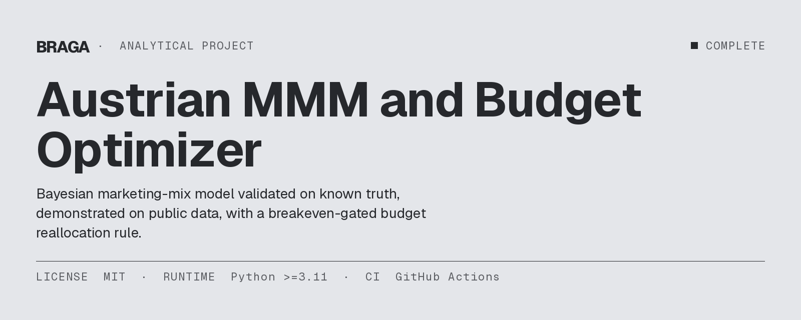
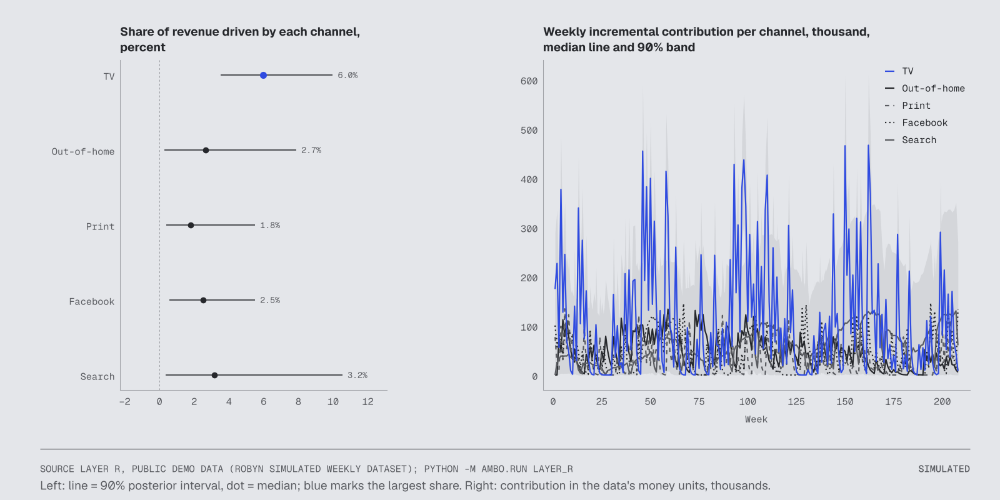
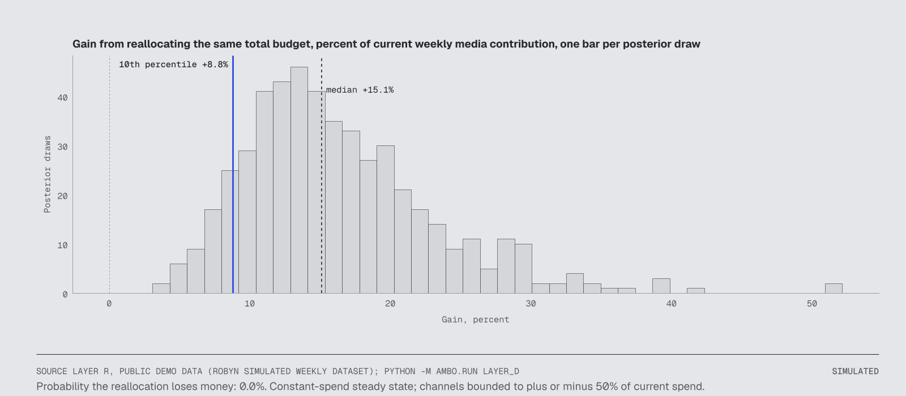
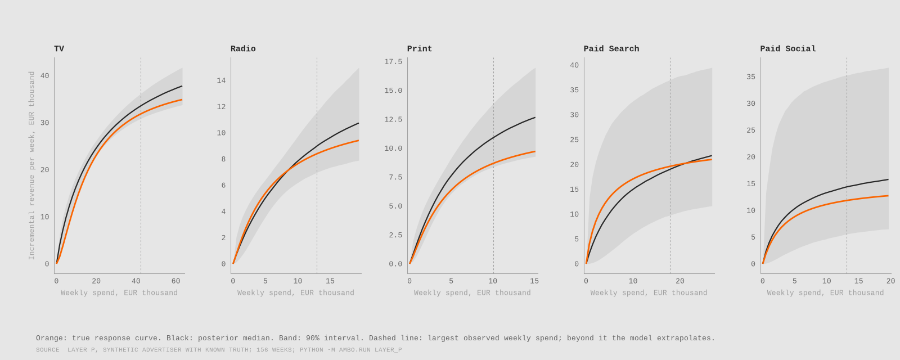
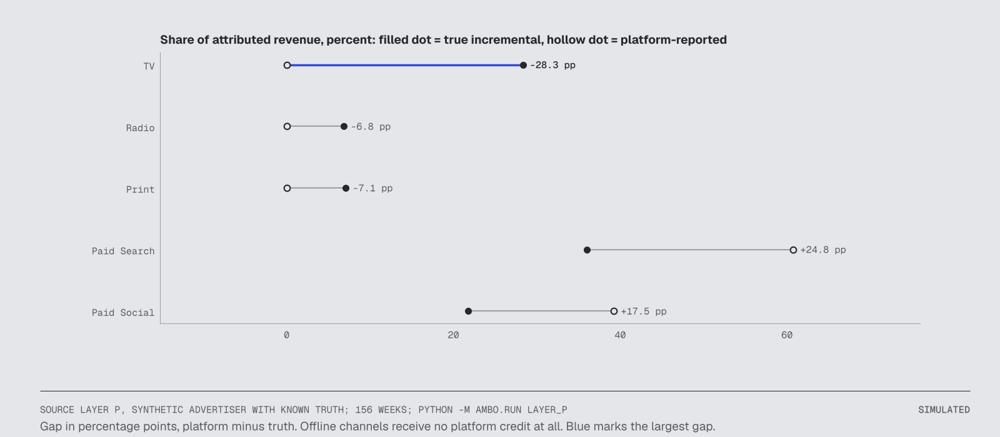
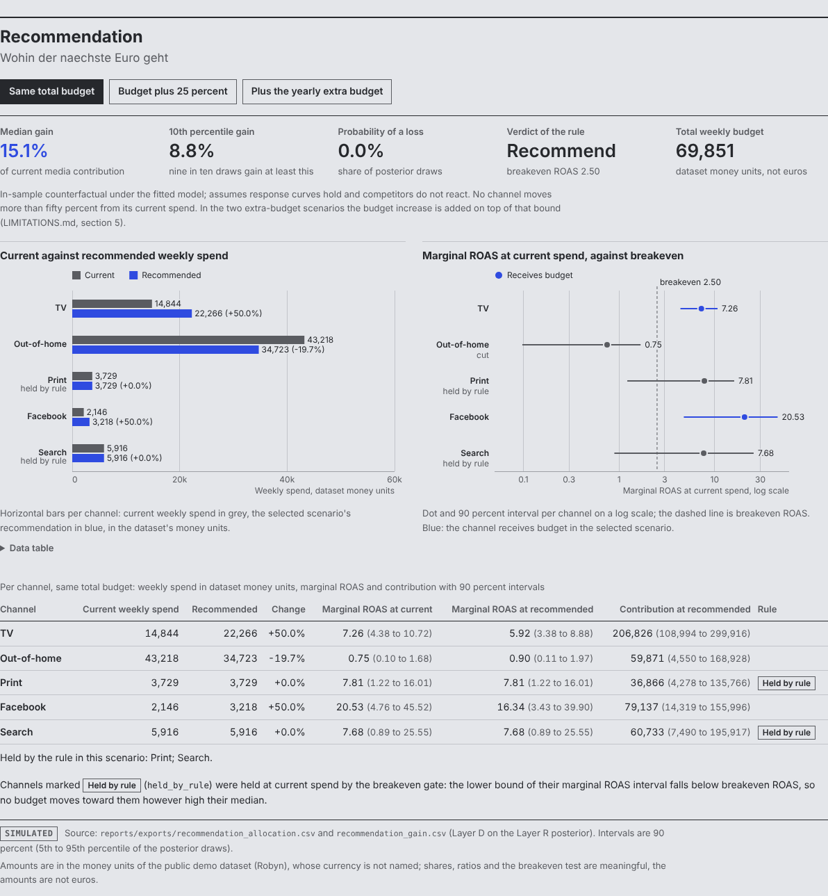
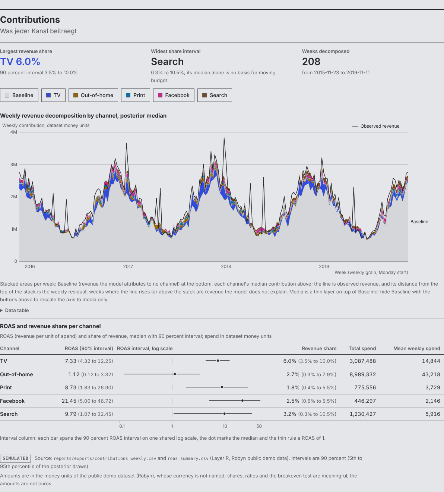
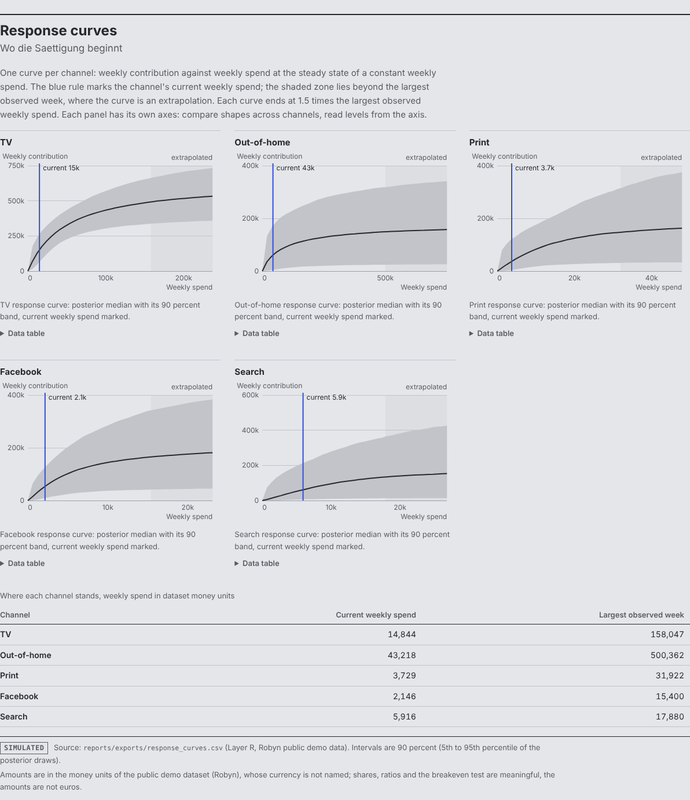
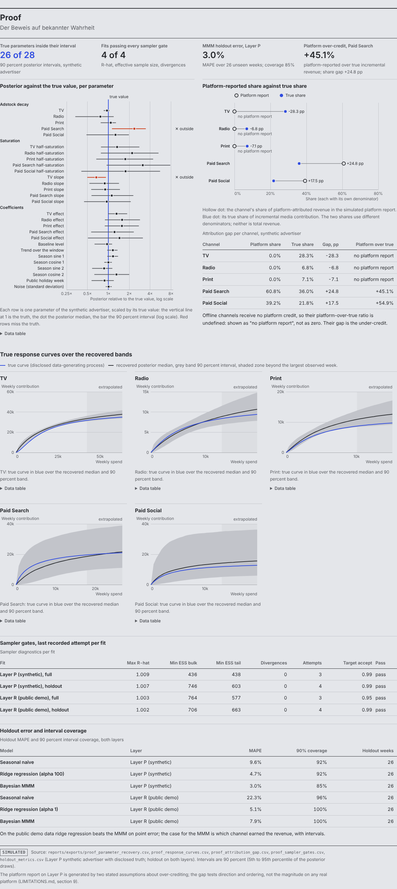
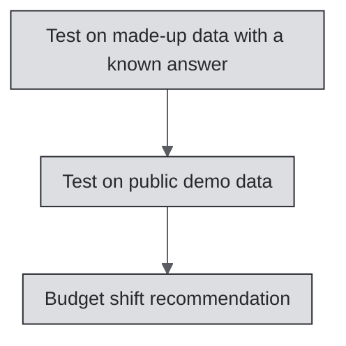

# Austrian MMM and Budget Optimizer



[](LICENSE)
[](pyproject.toml)
[](https://github.com/RafaelBraga-Kribitz/austrian-mmm-budget-optimizer/actions)
[](#status)

**Status:** Complete

- **Who decides:** the head of marketing or the CFO.
- **What they choose:** where to move the next euro of media budget.
- **Answer:** move weekly budget out of out-of-home (-20 percent) into TV and Facebook (+50 percent each). Media contribution gains a median 15.1 percent. Units are not euros.
- **Main caveat:** the numbers come from a public demo file, not Austrian client data, and the demo amounts are not euros.
- **Chart:** the share of revenue each channel drives, below.



*Left: share of revenue each channel drives, median and 90 percent interval. TV drives the largest share, 6.0 percent (3.5 to 10.0). Search has the widest interval (0.3 to 10.5 percent), so its median alone is no basis for moving budget. Right: weekly contribution per channel over the 208 weeks, in the demo file's money units. Units are not euros.*

## What it does

A marketing mix model (MMM) splits weekly revenue into a baseline and the part that each marketing channel caused. This repository builds one for a single advertiser.

The model is Bayesian. Each estimate comes with a 90 percent interval, not a single number.

The model answers three questions. Which channels contributed incrementally? How far off were the platform-reported numbers? What does a reallocation of the same budget gain?

Incremental revenue is revenue that would not have arrived without the channel's spend. Three steps build the answer:

1. The test on made-up data with a known answer asks whether the model can find a truth it was handed.
2. The test on public demo data fits the model on a public file.
3. The budget shift recommendation turns the fit into a decision under a breakeven rule.

**Which channels contributed?** On the public demo data, the share of revenue that each channel drives is:

| Channel | Share of revenue (percent) | 90 percent interval |
|---|---|---|
| TV | 6.0 | 3.5 to 10.0 |
| Out-of-home | 2.7 | 0.3 to 7.9 |
| Print | 1.8 | 0.4 to 5.5 |
| Facebook | 2.5 | 0.6 to 5.5 |
| Search | 3.2 | 0.3 to 10.5 |

**How far off was the platform report?** On made-up data with a known truth, the platform report credits Paid Search with 45 percent more revenue than it really adds. It gives the offline channels nothing.

**Does the model recover the truth?** On that made-up data, the estimated response curves cover the true curves on 91 percent of the observed spend range. A response curve shows the revenue that a channel adds at each weekly spend level. 26 of 28 true parameters fall inside their 90 percent intervals.

**What does a reallocation gain?** On the public demo data, with the same total budget, the median gain is 15.1 percent of current media contribution. The recommendation is in the Decision section. Units are not euros.

The word "Austrian" names the setting the model is built for, not the data behind it. The setting has the Austrian public-holiday calendar as a control, weekly grain, and euro and contribution-margin logic for an Austrian advertiser. The model is validated on made-up data with a known truth and demonstrated on public data, pending a client swap-in. No Austrian client data was used.

## Why this project exists

Platform dashboards over-credit their own channels, so an advertiser cannot see where the next euro of media should go. This project was meant to tell a head of marketing how to split the same budget. The pre-build evaluation expected about seven thousand euros of decision value over three yearly splits, against a central cost of about three thousand two hundred euros. That is about twice the cost, so it fails the four-times financial hurdle, and the recommendation was to defer. Observed result: Not yet measured; no advertiser data has arrived. Details: [economic evaluation](docs/economic-evaluation.md).

## Start here

| Audience | Start here |
|---|---|
| Recruiter | [Decision](#decision), the first chart and the [Dashboard](#dashboard) |
| Hiring manager | [Decision](#decision), [How it works](#how-it-works) and [Validation](#validation) |
| Technical reviewer | [How it fits together](#how-it-fits-together), [How to run](#how-to-run) and `src/ambo/` |
| Auditor | [Data](#data), [Validation](#validation) and [Known limits](#known-limits) |

## Decision

**Recommendation (public demo data, same total budget):** move weekly budget out of out-of-home and into TV and Facebook. Out-of-home returns 0.75 per extra unit of spend, below the breakeven return of 2.50, so it loses 20 percent of its spend. TV and Facebook each gain 50 percent.

Hold Print and Search. The lower end of their return interval falls below the breakeven return on ad spend (ROAS). TV and Facebook stop at the cap that the config puts on any channel's move: 50 percent of its current spend.

The expected gain is a median 15.1 percent of current media contribution. The 10th percentile is 8.8 percent. The probability of a loss is 0.0 percent across 500 posterior draws. Units are not euros, so the recommendation is stated in percent.

A posterior draw is one plausible set of model values that fits the data. In nine of ten draws, the gain is at least the 10th percentile.

Return on ad spend (ROAS) is revenue per unit of spend. Marginal ROAS is the revenue that the next unit of spend returns. Spend and contribution are weekly, in the dataset's money units, which are not euros.

| Channel | Current weekly spend | Recommended weekly spend | Change | Return on the next unit of spend, today (90 percent interval) | Return on the next unit of spend, after the shift (90 percent interval) | Media contribution after the shift (90 percent interval) |
|---|---|---|---|---|---|---|
| TV | 14844 | 22266 | +50 percent | 7.26 (4.38 to 10.72) | 5.92 (3.38 to 8.88) | 206826 (108994 to 299916) |
| Out-of-home | 43218 | 34723 | -20 percent | 0.75 (0.10 to 1.68) | 0.90 (0.11 to 1.97) | 59871 (4550 to 168928) |
| Print (held by the rule) | 3729 | 3729 | +0 percent | 7.81 (1.22 to 16.01) | 7.81 (1.22 to 16.01) | 36866 (4278 to 135766) |
| Facebook | 2146 | 3218 | +50 percent | 20.53 (4.76 to 45.52) | 16.34 (3.43 to 39.90) | 79137 (14319 to 155996) |
| Search (held by the rule) | 5916 | 5916 | +0 percent | 7.68 (0.89 to 25.55) | 7.68 (0.89 to 25.55) | 60733 (7490 to 195917) |

All amounts in the table are in the demo file's money units. Units are not euros.

Gain from the reallocation: median 15.1 percent of current media contribution, 10th percentile 8.8 percent, probability of a loss 0.0 percent. Units are not euros. Recommend the shift.

Decision rule: shift budget toward a channel only while the lower bound of its marginal ROAS 90 percent interval stays above the breakeven ROAS. Also require that the 10th percentile of the reallocation gain is positive.

Breakeven ROAS is 2.50 at a contribution margin of 40 percent. The config states that margin as an assumption. The breakeven gate held Print and Search at current spend. The lower bound of their marginal ROAS interval falls below breakeven, so no budget moves toward them, however high their median.

With 200000 more per year, spread over 52 weeks, media contribution rises by a median 17.4 percent (10th percentile 10.6 percent). The amounts are in dataset money units, and units are not euros. The rule says recommend. The file `reports/layer_d/next_200k.md` shows where the extra budget goes, channel by channel, and how likely that call is wrong.



*Gain from moving the same budget, one bar per posterior draw. None of the 500 posterior draws shows a loss. The blue line marks the 10th percentile (8.8 percent). The dashed line marks the median (15.1 percent). Units are not euros.*

Reconsider this recommendation if the real contribution margin is lower than the assumed one. Breakeven ROAS is 1 divided by the margin, so a lower margin raises the bar that every channel must clear. It can close the gate on a channel that the rule now lets grow.

Reconsider it also if a lift test measures an incremental effect outside the model's interval for that channel. A lift test is a geo experiment or a channel holdout.

## Results

Each model learns from the earlier weeks and forecasts the last weeks it has not seen. Error is the mean absolute percentage error (MAPE). Coverage is how often the actual week fell inside the model's 90 percent interval.

Two simple baselines set the bar. Seasonal naive repeats the revenue of 52 weeks earlier. Ridge regression is a plain regression with a penalty on large coefficients.

### Test on made-up data with a known answer: the MMM has the lowest holdout error, 3.0 percent against 4.7 percent for ridge regression

Holdout of 26 weeks on made-up data:

| Model | MAPE | 90 percent interval coverage |
|---|---|---|
| Seasonal naive | 9.6 percent | 92 percent |
| Ridge regression | 4.7 percent | 92 percent |
| Bayesian MMM | 3.0 percent | 85 percent |

The MMM has the lowest point error here. Its case does not rest on that, because the baselines say nothing about which channel earned the revenue. Its 90 percent intervals covered 85 percent of holdout weeks, 5 points below nominal. So the intervals are slightly too narrow and the model is a little overconfident. The wider intervals of the baselines covered more.

### Test on public demo data: ridge regression beats the MMM on holdout error, 5.1 percent against 7.9 percent

Holdout of 26 weeks on public demo data:

| Model | MAPE | 90 percent interval coverage |
|---|---|---|
| Seasonal naive | 22.3 percent | 96 percent |
| Ridge regression | 5.1 percent | 100 percent |
| Bayesian MMM | 7.9 percent | 100 percent |

The MMM loses on point error to the ridge regression baseline on this data. We report that as it comes out. The case for the MMM is interpretability, not always accuracy: it shows which channel earned the revenue, with intervals. Its 90 percent intervals covered 100 percent of holdout weeks, more than the nominal 90. So on this data the intervals are wider than they need to be.

## Validation



*Blue: the true response curve. Black: the posterior median. Band: the 90 percent interval. Dashed line: the largest observed weekly spend. Beyond it, the model extrapolates.*

Before anyone trusts the model on an advertiser's data, it had to recover a truth it was handed. On the made-up advertiser, the estimated response curves cover the true curves on 91 percent of the grid points inside the observed spend range. The worst channel is TV, at 56 percent. The mean error is at most 13.7 percent of the true curve's height. 26 of 28 individual parameters fall inside their 90 percent intervals.

The misses follow a known trade-off, not a bug. Each curve has two settings that trade off: how high it rises (the effect size) and how much spend it takes to level off (the half-saturation point; [How it works](#how-it-works) defines saturation). A curve that rises higher but levels off later fits the same observed weeks.

For that reason, 5 of 5 effect sizes and 5 of 5 half-saturation points have medians above the truth. We judge recovery on curves and shares, which a budget decision uses, not on point parameters.

Revenue shares are covered for 4 of 5 channels. The exception sits just outside its interval: TV, the largest channel by spend. Its true share is 9.5 percent, against an interval of 9.7 to 11.4.



*Hollow dot: the share of revenue that the platform report credits to a channel. Filled dot: its true share of incremental media contribution. Both are for the made-up advertiser. The two shares use different denominators, and neither is total revenue. The report over-credits Paid Search by 24.8 and Paid Social by 17.5 percentage points. It gives the offline channels nothing, although their true shares are TV 28.3, Print 7.1 and Radio 6.8 percent.*

The Results section shows holdout MAPE and interval coverage against two baselines. The code writes the sampler checks to `diagnostics.json` next to every fit.

## Dashboard

Four pages show the CSV feed in `reports/exports/`. The dashboard is built twice from the same files. The first build is a Power BI Project (`dashboards/MMM.pbip`): a model and a report kept as text files (TMDL and PBIR), so a test checks every visual against the model. The second build is a static HTML twin (`dashboards/html/index.html`): one file that works offline.

The screenshots below show the HTML twin. Power BI screenshots follow after the Desktop step in [dashboards/README.md](dashboards/README.md). The page specification is [docs/dashboard_handoff.md](docs/dashboard_handoff.md). The page subtitles are in German.



*Recommendation page, where the next euro goes. Pick a scenario, read the gain and the verdict of the rule, then see which channels gain budget and which the breakeven gate holds. Units are not euros.*



*Contributions page, what each channel contributes. It shows the weekly decomposition with observed revenue on top. It also shows ROAS and revenue share per channel with their intervals. Units are not euros.*



*Response curves page, where each channel levels off. It shows where each channel sits on its curve today. It also shows where the curve leaves the observed spend range.*



*Proof page, the test on known truth. It shows the same model on the made-up advertiser, judged against the disclosed truth.*

## Data

Weekly spend per channel and revenue. No Austrian client data was used.

| Test | Source | Grain and window | Tag |
|---|---|---|---|
| Made-up data with a known answer | Generated advertiser; true parameters in `data/synthetic/truth.json` | Weekly, 156 weeks, five channels (TV, Radio, Print, Paid Search, Paid Social) | `SIMULATED` |
| Public demo data | Robyn simulated weekly dataset (MIT, Meta Platforms); columns and licence in `data/README.md` | Weekly, 208 weeks, five named channels in the file's money units | `SIMULATED` |
| Control, made-up data | Austrian public-holiday week indicator | Weekly | `VERIFIED` |
| Assumption | Contribution margin 40 percent, breakeven ROAS 2.50, a placeholder in the public-demo config until a client margin is supplied | Decision rule | `ASSUMPTION` |

The amounts in the public demo data are not euros. Shares, ROAS ratios and the breakeven test stay meaningful. The amounts do not. A real-data swap-in is planned.

## Known limits

- The public demo data is Robyn's simulated weekly dataset. It has five named channels and revenue in money units whose currency its authors do not name. Shares, ROAS ratios and the breakeven test are meaningful. The amounts are not euros. No Austrian client data was used. A real-data swap-in is planned.
- The model assumes one form: carry-over that decays geometrically (adstock), a Hill saturation curve and an additive baseline. [How it works](#how-it-works) defines these terms. The test on made-up data shows that the sampler recovers this form. It does not show that reality has this form.
- Effect size and half-saturation point trade off against each other. So the model recovers individual point parameters less well than curves and shares. The Validation section states the direction of that bias.
- Weekly national data cannot separate channels whose spend moves together. The intervals widen accordingly. The optimiser stays inside the bounds that the config sets.
- The optimiser assumes that response curves hold at new spend levels. It assumes that competitors do not react. It assumes that a constant weekly spend reaches its steady state.

[LIMITATIONS.md](LIMITATIONS.md) lists every limit and what each one means for a client engagement. The decisions behind the build are in [docs/adr/](docs/adr/README.md). The dashboard specification is in [docs/dashboard_handoff.md](docs/dashboard_handoff.md) and its build is in [dashboards/README.md](dashboards/README.md).

## What I would do differently with production data

- Geo-level weekly data, so that regional variation in spend identifies the response curves, not time alone.
- Calibration against lift tests: geo experiments or holdouts on at least one channel, used as priors or as a check on the incremental estimates.
- Media cost inflation, so that spend converts to reach before modelling and a price rise does not look like saturation.
- Competitor spend as a control, since a rival's campaign moves the baseline.
- Longer history for seasonality: three full years at minimum, with the calendar of promotions written down, not reconstructed.
- Data-quality gates before modelling: gapless weeks, spend reconciled to invoices, platform exports reconciled to the ad accounts, and outliers explained before they enter the fit.

## Why this project

Contribution profit is the north star, not revenue. A channel that returns less than the breakeven return on ad spend destroys margin, however large its revenue looks.

Customer acquisition cost must be fully loaded, or it is fiction. Attribution is a hypothesis until a test outside the platform's own reporting checks it.

Platform-reported numbers are claims, not measurements. Every platform counts the conversions it can see. It credits itself for demand that would have arrived anyway. The model in this repository tests those claims.

## How it works

The sections above use a few modelling terms. This section defines each one once.

- **Adstock:** geometric carry-over per channel. This week's spend keeps working in the following weeks, with a decay rate that the model estimates.
- **Saturation:** a Hill curve per channel on the carried-over spend. It has a half-saturation point and a slope, so returns diminish as spend grows.
- **Seasonality and controls:** a linear trend, two yearly Fourier pairs (sine and cosine terms for the yearly pattern) and one control. The control is a public-holiday week indicator on the made-up data and competitor sales on the public demo data.
- **Priors:** a prior is the assumption that the model holds before it sees the data. The priors here are weakly informative and identical across channels, on scaled data. So the estimates come from the data, not from a prior that knows the answer. The model docstring gives each prior and its reasoning.
- **Sampler:** the No-U-Turn Sampler (NUTS, run through nutpie) with 2 chains and 1000 tuning draws. It starts at target acceptance 0.9 with 1000 draws per chain. When a gate fails, a recorded ladder raises the target acceptance and then the draws. Both reported fits ran at target acceptance 0.95 with 2000 draws per chain, on attempt 3.
- **R-hat:** a check that compares the sampler chains with each other. A value near 1 means the chains agree.
- **Diagnostics:** R-hat below 1.01, effective sample size above 400 and zero divergences. The code writes them to `diagnostics.json` next to every fit.
- **Holdout protocol:** fit on the first 130 of 156 weeks on the made-up data and on the first 182 of 208 weeks on the public demo data. Forecast the rest with the actual spend. Report MAPE and 90 percent interval coverage against a seasonal-naive and a ridge-regression baseline.

## How it fits together



The test on made-up data is the validation instrument. It uses a disclosed data-generating process that the sampler must recover before anyone treats the public-demo numbers as a decision. The test on public demo data fits the same model on Robyn's public demo file. The budget shift recommendation takes the posterior of that fit and reallocates spend under the breakeven rule.

| Piece | Role |
|---|---|
| PyMC and nutpie | Bayesian MMM, NUTS sampling |
| uv | Locked install and run |
| bk-viz | Chart theme |

## How to run

```bash
uv sync
uv run pytest -m "not slow"
uv run python -m ambo.run layer_p
uv run python -m ambo.run layer_r && uv run python -m ambo.run layer_d
uv run python scripts/render_readme.py
```

A renderer builds this README from `scripts/readme_template.md` and reads every number from `reports/`. The three run commands regenerate those artifacts. The test `tests/test_readme_numbers.py` fails when the committed README, memo or German summary no longer match what the renderers produce.

## Repository structure

| Path | Responsibility |
|---|---|
| `src/ambo/` | Model, sampler, optimiser, charts, configs |
| `data/` | Made-up advertiser and public demo file |
| `reports/` | Artifacts of the three steps; the README is rendered from them |
| `scripts/` | README, memo and German summary renderers, notebook builder, dashboard export, HTML twin builder, PBIP schema check |
| `dashboards/` | Power BI Project (TMDL model, PBIR report) and the static HTML twin of the dashboard |
| `tests/` | Recovery, transforms, optimiser, the README-numbers gate, and the dashboard model-report checks |
| `docs/` | Specs, ADRs, dashboard handoff, build log |
| `notebooks/` | Walkthrough notebook |

### Legend: short names in files and charts

Folder names, run commands and chart footers use short names. This README uses the plain names.

| Short name | Plain name used in this README |
|---|---|
| `layer_p`, Layer P | Test on made-up data with a known answer |
| `layer_r`, Layer R | Test on public demo data |
| `layer_d`, Layer D | Budget shift recommendation |

## Status

**Status:** Complete

Built steps: the test on made-up data with a known answer (synthetic truth and parameter recovery), the test on public demo data, and the budget shift recommendation (budget optimiser and decision rule). Everything in this README regenerates from the three run commands above. Last validated: 2026-09-16.

## License

MIT License. See [LICENSE](LICENSE).

## Author

<table>
  <tr>
    <td width="110">
      
    </td>
    <td>
      <strong>Rafael Braga-Kribitz</strong><br />
      Seiersberg-Pirka, Austria · Portfolio project, 2026<br />
      <a href="https://www.linkedin.com/in/rafaelbragakribitz/">LinkedIn</a>
      ·
      <a href="mailto:rafaelbragakribitz@gmail.com">rafaelbragakribitz@gmail.com</a>
    </td>
  </tr>
</table>
