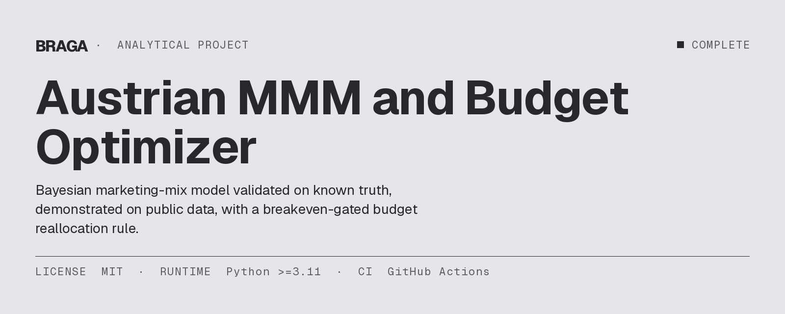
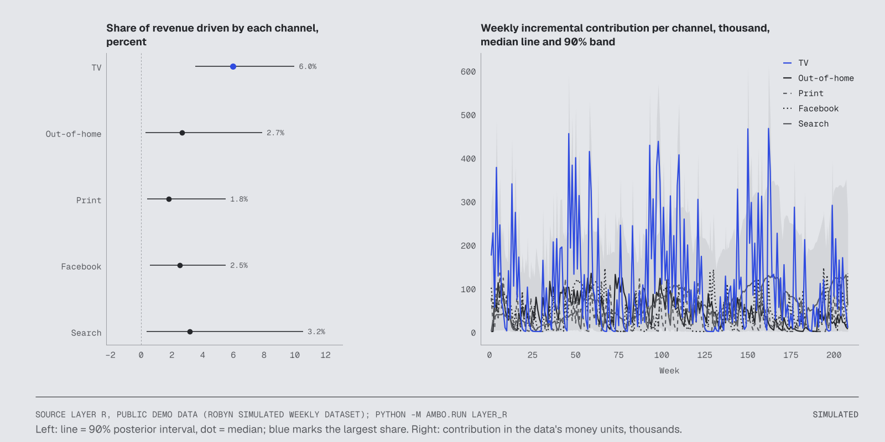
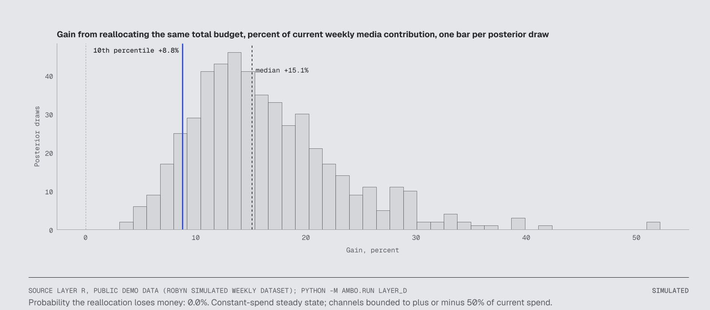
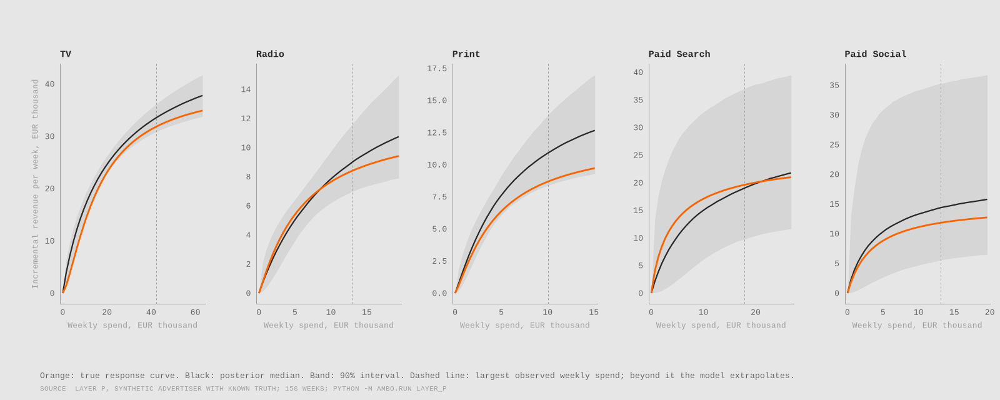
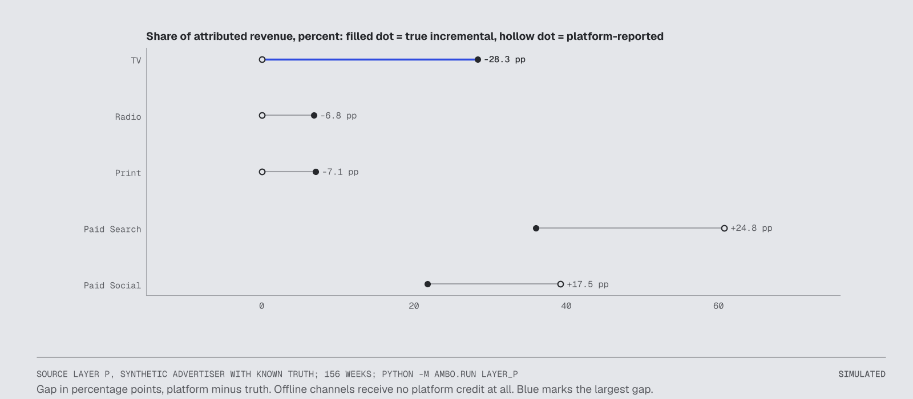
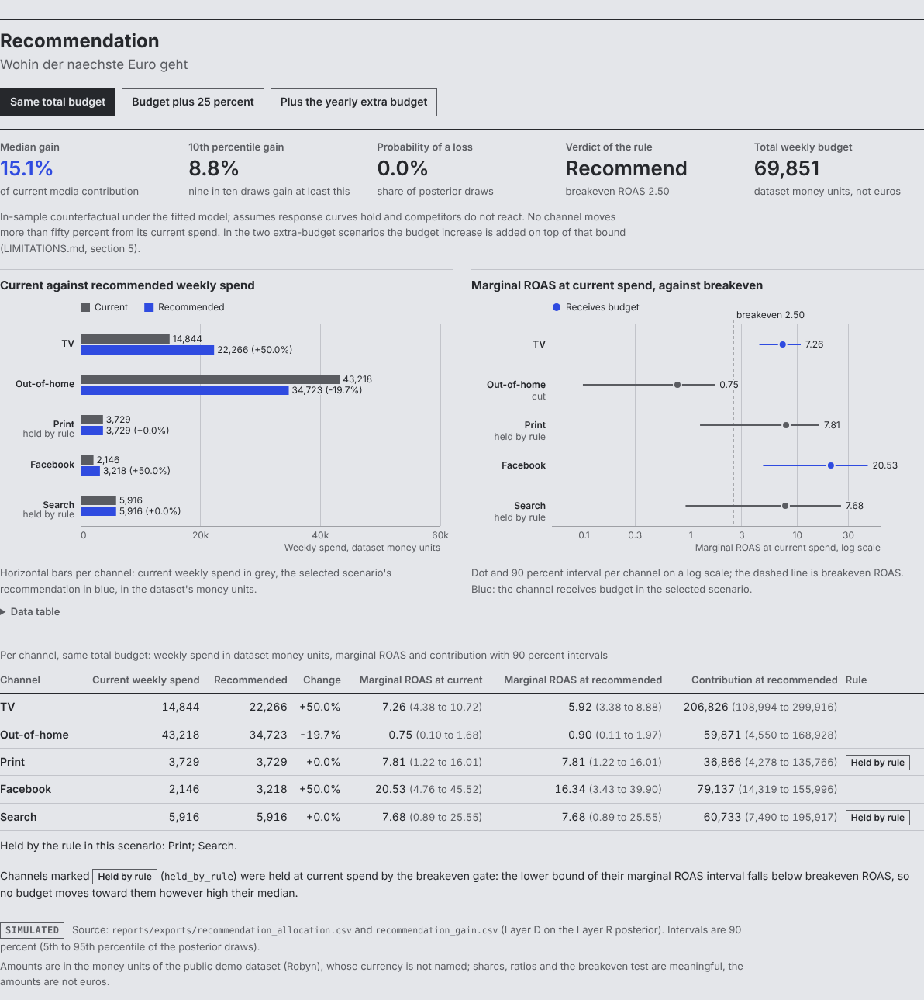
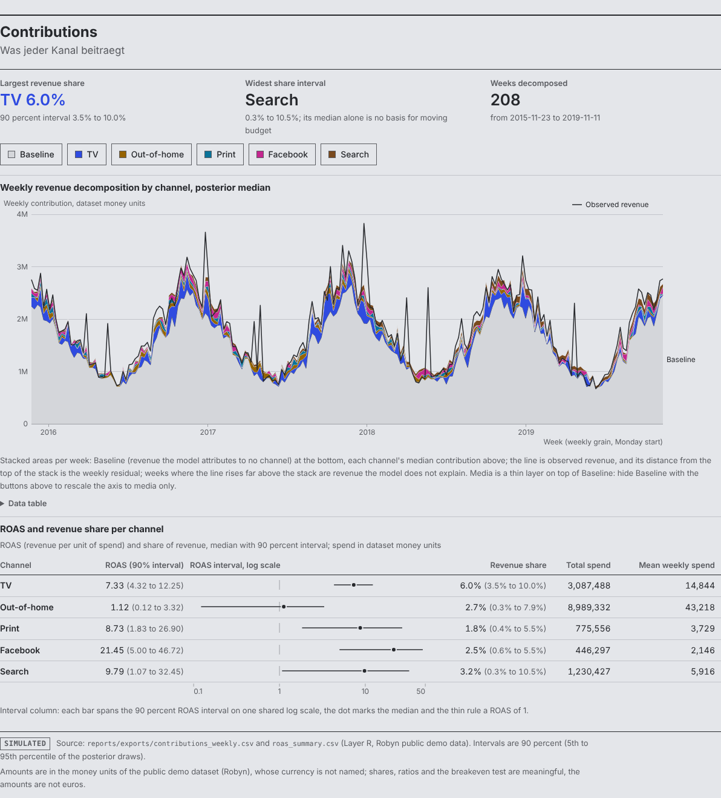
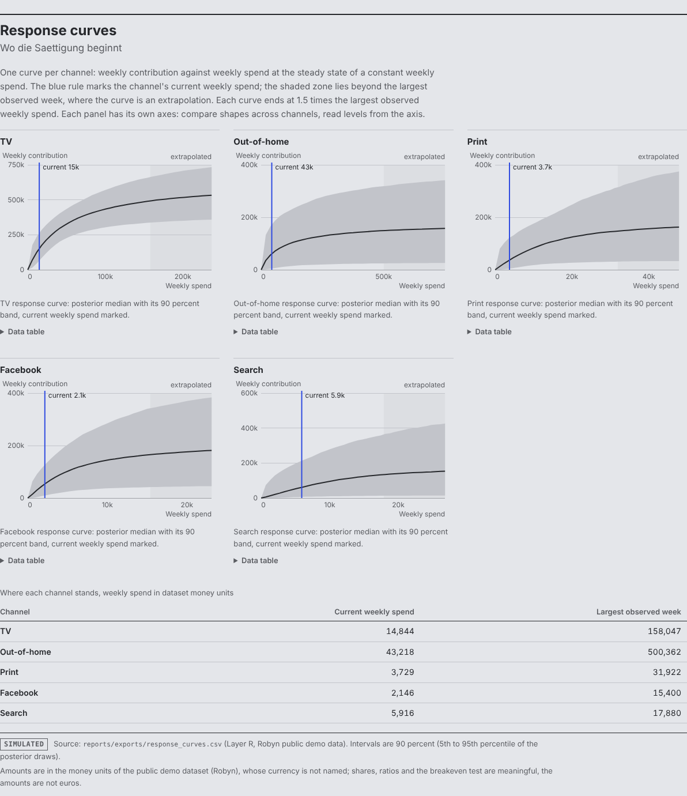
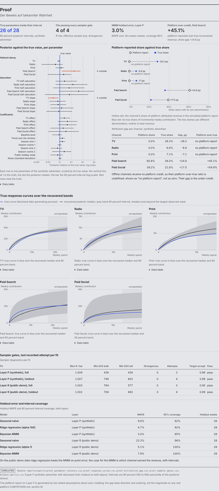
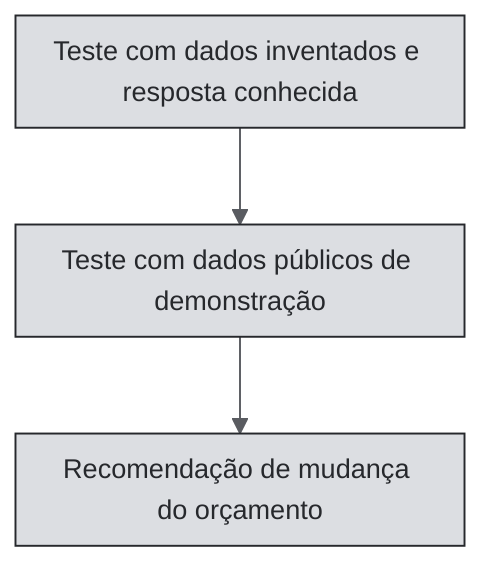

[🇧🇷 PT-BR](README.pt-BR.md) · [🇬🇧 EN-UK](README.md) · [🇦🇹 DE-AT](README.de-AT.md)

# MMM austríaco e otimizador de orçamento



[](LICENSE)
[](pyproject.toml)
[](https://github.com/RafaelBraga-Kribitz/austrian-mmm-budget-optimizer/actions)
[](#status)

**Status:** Concluído

- **Quem decide:** a pessoa responsável por marketing ou o CFO.
- **O que escolhe:** para onde mover o próximo euro do orçamento de mídia.
- **Resposta:** transferir o orçamento semanal de mídia out-of-home (-20%) para TV e Facebook (+50% cada). A contribuição de mídia aumenta 15,1% na mediana. Os valores não estão em euros.
- **Principal ressalva:** os números vêm de uma base pública de demonstração, não de dados de clientes austríacos; os valores da demonstração não são euros.
- **Gráfico:** a participação na receita gerada por cada canal, abaixo.



*Esquerda: participação na receita gerada por cada canal, com mediana e intervalo de 90%. TV gera a maior participação, 6,0% (3,5 a 10,0). Search tem o intervalo mais amplo (0,3 a 10,5%), portanto sua mediana, isoladamente, não justifica uma mudança de orçamento. Direita: contribuição semanal de cada canal nas 208 semanas, nas unidades monetárias da base de demonstração. Os valores não são euros.*

## O que faz

Um modelo de marketing mix (MMM) divide a receita semanal em uma linha de base e na parcela que cada canal de marketing causou. Este repositório constrói um modelo para um único anunciante.

O modelo é bayesiano. Cada estimativa vem com um intervalo de 90%, não apenas um número.

O modelo responde a três perguntas: quais canais tiveram contribuição incremental? Quanto os números reportados pelas plataformas estavam errados? O que se ganha ao realocar o mesmo orçamento?

Receita incremental é a receita que não teria chegado sem o investimento do canal. Três etapas constroem a resposta:

1. O teste com dados inventados e resposta conhecida verifica se o modelo recupera uma verdade que lhe foi fornecida.
2. O teste com dados públicos de demonstração ajusta o modelo a um arquivo público.
3. A recomendação de mudança do orçamento transforma o ajuste em uma decisão sob uma regra de ponto de equilíbrio.

**Quais canais contribuíram?** Na base pública de demonstração, a participação na receita gerada por cada canal é:

| Canal | Participação na receita (porcentagem) | Intervalo de 90% |
|---|---|---|
| TV | 6.0 | 3.5 a 10.0 |
| Out-of-home | 2.7 | 0.3 a 7.9 |
| Print | 1.8 | 0.4 a 5.5 |
| Facebook | 2.5 | 0.6 a 5.5 |
| Search | 3.2 | 0.3 a 10.5 |

**Quanto o relatório da plataforma errou?** Nos dados inventados com verdade conhecida, o relatório da plataforma atribui ao Paid Search 45% mais receita do que ele realmente acrescenta. Não atribui nada aos canais offline.

**O modelo recupera a verdade?** Nesses dados inventados, as curvas de resposta estimadas cobrem as curvas verdadeiras em 91% do intervalo de gastos observado. Uma curva de resposta mostra a receita acrescentada por um canal em cada nível de investimento semanal. 26 dos 28 parâmetros verdadeiros ficam dentro dos intervalos de 90%.

**O que se ganha com a realocação?** Nos dados públicos de demonstração, mantendo o mesmo orçamento total, o ganho mediano é de 15,1% da contribuição de mídia atual. A recomendação está na seção Decisão. Os valores não são euros.

A palavra “austríaco” identifica o contexto para o qual o modelo foi concebido, não os dados usados. O contexto inclui o calendário de feriados públicos austríacos como controle, granularidade semanal e lógica de euros e margem de contribuição para um anunciante austríaco. O modelo é validado com dados inventados de verdade conhecida e demonstrado com dados públicos, à espera da substituição por dados de um cliente. Nenhum dado de cliente austríaco foi usado.

## Por que este projeto existe

Os dashboards das plataformas superestimam a contribuição dos próprios canais, então o anunciante não consegue saber para onde deve ir o próximo euro de mídia. Este projeto deveria mostrar à pessoa responsável pelo marketing de um grande anunciante austríaco como dividir o mesmo orçamento com um modelo próprio. A avaliação anterior à construção estimou cerca de €80 mil em valor decisório ao longo de três decisões anuais de alocação, diante de um custo central de aproximadamente €14 mil. Isso equivale a quase seis vezes o custo e supera o requisito financeiro de quatro vezes, sob as hipóteses adotadas. Resultado observado: ainda não medido. Detalhes: [avaliação econômica](docs/economic-evaluation.md).

## Comece por aqui

| Público | Comece por |
|---|---|
| Recrutador | [Decisão](#decisão), primeiro gráfico e [Dashboard](#dashboard) |
| Gestor de contratação | [Decisão](#decisão), [Como funciona](#como-funciona) e [Validação](#validação) |
| Revisor técnico | [Como as partes se conectam](#como-as-partes-se-conectam), [Como executar](#como-executar) e `src/ambo/` |
| Auditor | [Dados](#dados), [Validação](#validação) e [Limitações conhecidas](#limitações-conhecidas) |

## Decisão

**Recomendação (dados públicos de demonstração, mesmo orçamento total):** transferir o orçamento semanal de out-of-home para TV e Facebook. O retorno marginal de out-of-home é 0,75 por unidade adicional investida, abaixo do retorno de equilíbrio de 2,50; por isso, o investimento cai 20%. TV e Facebook aumentam 50% cada.

Manter Print e Search. O limite inferior do intervalo de retorno deles fica abaixo do retorno de equilíbrio sobre o investimento em publicidade (ROAS). TV e Facebook param no limite definido na configuração para a mudança de cada canal: 50% do investimento atual.

O ganho esperado é de 15,1% da contribuição de mídia atual na mediana. O percentil 10 é 8,8%. A probabilidade de perda é 0,0% nas 500 amostras posteriores. Como os valores não são euros, a recomendação é expressa em porcentagem.

Uma amostra posterior é um conjunto plausível de valores do modelo compatível com os dados. Em nove de cada dez amostras, o ganho é pelo menos igual ao percentil 10.

Retorno sobre o investimento em publicidade (ROAS) é receita por unidade investida. ROAS marginal é a receita que a próxima unidade investida retorna. Os gastos e a contribuição são semanais e estão nas unidades monetárias do conjunto de dados, que não são euros.

| Canal | Investimento semanal atual | Investimento semanal recomendado | Variação | Retorno da próxima unidade investida, agora (intervalo de 90%) | Retorno da próxima unidade após a mudança (intervalo de 90%) | Contribuição de mídia após a mudança (intervalo de 90%) |
|---|---|---|---|---|---|---|
| TV | 14844 | 22266 | +50% | 7.26 (4.38 a 10.72) | 5.92 (3.38 a 8.88) | 206826 (108994 a 299916) |
| Out-of-home | 43218 | 34723 | -20% | 0.75 (0.10 a 1.68) | 0.90 (0.11 a 1.97) | 59871 (4550 a 168928) |
| Print (mantido pela regra) | 3729 | 3729 | +0% | 7.81 (1.22 a 16.01) | 7.81 (1.22 a 16.01) | 36866 (4278 a 135766) |
| Facebook | 2146 | 3218 | +50% | 20.53 (4.76 a 45.52) | 16.34 (3.43 a 39.90) | 79137 (14319 a 155996) |
| Search (mantido pela regra) | 5916 | 5916 | +0% | 7.68 (0.89 a 25.55) | 7.68 (0.89 a 25.55) | 60733 (7490 a 195917) |

Todos os valores monetários da tabela usam as unidades da base de demonstração. Não são euros.

Ganho com a realocação: mediana de 15,1% da contribuição de mídia atual, percentil 10 de 8,8%, probabilidade de perda de 0,0%. Os valores não são euros. A regra recomenda a mudança.

Regra decisória: mover orçamento para um canal somente enquanto o limite inferior do intervalo de 90% do ROAS marginal permanecer acima do ROAS de equilíbrio. Também é necessário que o percentil 10 do ganho de realocação seja positivo.

O ROAS de equilíbrio é 2,50 com margem de contribuição de 40%. A configuração registra essa margem como hipótese. O filtro de equilíbrio manteve Print e Search no investimento atual. O limite inferior do intervalo de ROAS marginal deles fica abaixo do equilíbrio, portanto não recebem orçamento, por maior que seja a mediana.

Com mais 200.000 por ano, distribuídos ao longo de 52 semanas, a contribuição de mídia aumenta 17,4% na mediana (percentil 10 de 10,6%). Os valores usam as unidades monetárias do conjunto de dados, não euros. A regra recomenda o aumento. O arquivo `reports/layer_d/next_200k.md` mostra para onde vai o orçamento adicional, canal por canal, e a probabilidade de essa decisão estar errada.



*Ganho de mover o mesmo orçamento, uma barra por amostra posterior. Nenhuma das 500 amostras posteriores apresenta perda. A linha azul marca o percentil 10 (8,8%). A linha tracejada marca a mediana (15,1%). Os valores não são euros.*

Reconsidere esta recomendação se a margem de contribuição real for menor que a hipótese. O ROAS de equilíbrio é 1 dividido pela margem; portanto, uma margem menor eleva o limite que cada canal precisa superar. Isso pode fechar o filtro para um canal que hoje pode crescer.

Reconsidere-a também se um teste de lift medir um efeito incremental fora do intervalo do modelo para aquele canal. Um teste de lift é um experimento geográfico ou um grupo de controle sem o canal.

## Resultados

Cada modelo aprende com as semanas anteriores e prevê as últimas semanas, que não viu. O erro é o erro percentual absoluto médio (MAPE). A cobertura mostra com que frequência a semana observada ficou dentro do intervalo de 90% do modelo.

Duas linhas de base simples definem a referência. A linha de base sazonal ingênua repete a receita de 52 semanas antes. A regressão ridge é uma regressão simples com penalidade para coeficientes grandes.

### Teste com dados inventados de verdade conhecida: o MMM tem o menor erro no holdout, 3,0% contra 4,7% da regressão ridge

Holdout de 26 semanas em dados inventados:

| Modelo | MAPE | Cobertura do intervalo de 90% |
|---|---|---|
| Sazonal ingênuo | 9.6% | 92% |
| Regressão ridge | 4.7% | 92% |
| MMM bayesiano | 3.0% | 85% |

O MMM tem o menor erro pontual aqui. A justificativa para usá-lo não depende apenas disso, pois as linhas de base não dizem quais canais geraram a receita. Os intervalos de 90% cobriram 85% das semanas de holdout, cinco pontos abaixo do valor nominal. Portanto, os intervalos são um pouco estreitos demais e o modelo é ligeiramente confiante em excesso. Os intervalos mais amplos das linhas de base tiveram maior cobertura.

### Teste com dados públicos de demonstração: a regressão ridge supera o MMM no erro de holdout, 5,1% contra 7,9%

Holdout de 26 semanas nos dados públicos de demonstração:

| Modelo | MAPE | Cobertura do intervalo de 90% |
|---|---|---|
| Sazonal ingênuo | 22.3% | 96% |
| Regressão ridge | 5.1% | 100% |
| MMM bayesiano | 7.9% | 100% |

Neste conjunto, o MMM perde para a regressão ridge no erro pontual. Reportamos o resultado como ele é. A justificativa do MMM é interpretabilidade, não precisão superior em todos os casos: ele mostra qual canal gerou a receita, com intervalos. Seus intervalos de 90% cobriram 100% das semanas de holdout, acima dos 90% nominais. Assim, neste conjunto, os intervalos são mais amplos do que precisam ser.

## Validação



*Azul: curva de resposta verdadeira. Preto: mediana posterior. Faixa: intervalo de 90%. Linha tracejada: maior gasto semanal observado. Acima desse valor, o modelo extrapola.*

Antes de confiar no modelo com dados de um anunciante, ele precisava recuperar uma verdade que lhe foi fornecida. Para o anunciante inventado, as curvas de resposta estimadas cobrem as curvas verdadeiras em 91% dos pontos da grade dentro do intervalo de investimento observado. O pior canal é TV, com 56%. O erro médio tem altura máxima de 13,7% da curva verdadeira. 26 dos 28 parâmetros individuais ficam dentro dos respectivos intervalos de 90%.

As diferenças decorrem de um trade-off conhecido, não de um bug. Cada curva tem dois parâmetros que compensam um ao outro: o quanto ela cresce (tamanho do efeito) e quanto investimento leva para se estabilizar (ponto de meia saturação; [Como funciona](#como-funciona) define saturação). Uma curva que cresce mais, mas demora a se estabilizar, pode ajustar as mesmas semanas observadas.

Por isso, as medianas de 5 de 5 tamanhos de efeito e de 5 de 5 pontos de meia saturação ficam acima dos valores verdadeiros. Avaliamos a recuperação pelas curvas e participações, que são usadas na decisão orçamentária, não pelos parâmetros pontuais.

As participações de receita são cobertas em 4 dos 5 canais. A exceção fica logo fora do intervalo: TV, o canal com maior investimento. Sua participação verdadeira é 9,5%, contra intervalo de 9,7 a 11,4%.



*Ponto vazado: participação da receita atribuída a um canal pelo relatório da plataforma. Ponto preenchido: participação verdadeira na contribuição incremental de mídia. Ambos correspondem ao anunciante inventado. As participações usam denominadores diferentes, e nenhuma representa a receita total. O relatório superestima Paid Search em 24,8 e Paid Social em 17,5 pontos percentuais. Não atribui nada aos canais offline, embora suas participações verdadeiras sejam TV 28,3%, Print 7,1% e Radio 6,8%.*

A seção Resultados mostra MAPE do holdout e cobertura dos intervalos em comparação com duas linhas de base. O código grava as verificações do sampler em `diagnostics.json`, ao lado de cada ajuste.

## Dashboard

Quatro páginas mostram os dados CSV em `reports/exports/`. O dashboard é construído de duas formas a partir dos mesmos arquivos. A primeira é um projeto Power BI (`dashboards/MMM.pbip`): modelo e relatório mantidos como arquivos de texto (TMDL e PBIR), permitindo que um teste compare cada visualização ao modelo. A segunda é uma versão HTML estática equivalente (`dashboards/html/index.html`): um único arquivo que funciona offline.

As capturas abaixo mostram a versão HTML. As capturas do Power BI virão depois da etapa no Desktop descrita em [dashboards/README.md](dashboards/README.md). A especificação das páginas está em [docs/dashboard_handoff.md](docs/dashboard_handoff.md). Os subtítulos das páginas estão em alemão.



*Página Recomendação: para onde vai o próximo euro. Escolha um cenário, veja o ganho e o resultado da regra e, em seguida, identifique quais canais recebem orçamento e quais são bloqueados pelo ponto de equilíbrio. Os valores não são euros.*



*Página Contribuições: quanto cada canal contribui. Mostra a decomposição semanal com a receita observada no topo, além de ROAS e participação na receita por canal com seus intervalos. Os valores não são euros.*



*Página Curvas de resposta: onde cada canal começa a se estabilizar. Mostra a posição atual de cada canal na curva e o ponto em que a curva sai do intervalo de gastos observado.*



*Página Evidências: o teste com verdade conhecida. Mostra o mesmo modelo para o anunciante inventado, comparado à verdade explicitada.*

## Dados

Gasto semanal por canal e receita. Nenhum dado de cliente austríaco foi usado.

| Teste | Fonte | Granularidade e período | Classificação |
|---|---|---|---|
| Dados inventados com resposta conhecida | Anunciante gerado; parâmetros verdadeiros em `data/synthetic/truth.json` | Semanal, 156 semanas, cinco canais (TV, Radio, Print, Paid Search, Paid Social) | `SIMULATED` |
| Dados públicos de demonstração | Conjunto semanal simulado do Robyn (MIT, Meta Platforms); colunas e licença em `data/README.md` | Semanal, 208 semanas, cinco canais nomeados nas unidades monetárias do arquivo | `SIMULATED` |
| Controle, dados inventados | Indicador semanal de feriados públicos austríacos | Semanal | `VERIFIED` |
| Hipótese | Margem de contribuição de 40%, ROAS de equilíbrio de 2,50, valor provisório na configuração de demonstração pública até que a margem do cliente seja informada | Regra decisória | `ASSUMPTION` |

Os valores da demonstração pública não são euros. Participações, razões ROAS e o teste de equilíbrio continuam úteis. Os valores monetários, não. Está prevista a substituição por dados reais.

## Limitações conhecidas

- A base pública de demonstração é o conjunto semanal simulado do Robyn. Contém cinco canais nomeados e receita em unidades monetárias cuja moeda não é informada pelos autores. Participações, razões ROAS e o teste de equilíbrio são úteis; os valores não são euros. Nenhum dado de cliente austríaco foi usado. Está prevista a substituição por dados reais.
- O modelo presume uma única forma: efeito residual que decai geometricamente (adstock), curva de saturação de Hill e uma linha de base aditiva. [Como funciona](#como-funciona) define esses termos. O teste com dados inventados mostra que o sampler recupera essa forma. Não demonstra que a realidade tenha essa forma.
- Tamanho do efeito e ponto de meia saturação compensam-se. Por isso, o modelo recupera parâmetros pontuais individuais com menos precisão do que as curvas e participações. A seção Validação descreve a direção desse viés.
- Dados nacionais semanais não conseguem separar canais cujos investimentos variam juntos. Os intervalos ficam mais amplos por isso. O otimizador permanece dentro dos limites definidos pela configuração.
- O otimizador presume que as curvas de resposta continuam válidas em novos níveis de investimento, que concorrentes não reagem e que um investimento semanal constante chega ao estado estacionário.

[`LIMITATIONS.md`](LIMITATIONS.md) lista cada limitação e o que ela significa para um trabalho com cliente. As decisões por trás da construção estão em [docs/adr/](docs/adr/README.md). A especificação do dashboard está em [docs/dashboard_handoff.md](docs/dashboard_handoff.md), e sua construção está em [dashboards/README.md](dashboards/README.md).

## O que eu faria diferente com dados de produção

- Dados semanais por região, para que a variação regional do investimento identifique as curvas de resposta, e não apenas o tempo.
- Calibração com testes de lift: experimentos geográficos ou grupos de controle sem pelo menos um canal, usados como priori ou como verificação das estimativas incrementais.
- Inflação dos custos de mídia, para converter investimento em alcance antes da modelagem e evitar que um aumento de preço pareça saturação.
- Investimento dos concorrentes como variável de controle, pois uma campanha rival altera a linha de base.
- Histórico mais longo para sazonalidade: no mínimo três anos completos, com o calendário de promoções registrado, não reconstruído.
- Controles de qualidade de dados antes da modelagem: semanas sem lacunas, gastos conciliados com faturas, exportações das plataformas conciliadas com as contas de anúncios e outliers explicados antes do ajuste.

## Por que este projeto

O lucro de contribuição é a métrica principal, não a receita. Um canal que retorna menos que o ROAS de equilíbrio destrói margem, por maior que pareça sua receita.

O custo de aquisição de clientes precisa incluir todos os custos; caso contrário, é fictício. A atribuição é uma hipótese até que um teste independente do próprio relatório da plataforma a verifique.

Os números reportados pelas plataformas são alegações, não medições. Cada plataforma conta as conversões que consegue observar e atribui a si mesma uma demanda que teria chegado de qualquer forma. O modelo deste repositório testa essas alegações.

## Como funciona

As seções acima usam alguns termos de modelagem. Esta seção define cada um uma única vez.

- **Adstock:** efeito residual geométrico por canal. O investimento desta semana continua atuando nas semanas seguintes, com uma taxa de decaimento estimada pelo modelo.
- **Saturação:** curva de Hill por canal aplicada ao investimento acumulado pelo adstock. Ela tem um ponto de meia saturação e uma inclinação, de modo que os retornos diminuem à medida que o investimento cresce.
- **Sazonalidade e controles:** tendência linear, dois pares de Fourier anuais (termos de seno e cosseno para o padrão anual) e um controle. Nos dados inventados, o controle é um indicador semanal de feriados; na demonstração pública, são as vendas dos concorrentes.
- **Priori:** uma priori é a hipótese que o modelo mantém antes de observar os dados. As prioris aqui são fracamente informativas e idênticas para todos os canais, em dados escalados. Assim, as estimativas vêm dos dados, não de uma priori que já conhece a resposta. A docstring do modelo explica cada priori e sua justificativa.
- **Sampler:** No-U-Turn Sampler (NUTS, executado via nutpie), com 2 cadeias e 1.000 amostras de ajuste. Começa com aceitação-alvo de 0,9 e 1.000 amostras por cadeia. Se um controle falha, uma sequência registrada aumenta primeiro a aceitação-alvo e depois o número de amostras. Os dois ajustes reportados rodaram com aceitação-alvo de 0,95 e 2.000 amostras por cadeia, na terceira tentativa.
- **R-hat:** verificação que compara as cadeias do sampler entre si. Um valor próximo de 1 indica concordância entre as cadeias.
- **Diagnósticos:** R-hat abaixo de 1,01, tamanho amostral efetivo acima de 400 e zero divergências. O código grava os diagnósticos em `diagnostics.json`, ao lado de cada ajuste.
- **Protocolo de holdout:** ajustar as primeiras 130 das 156 semanas nos dados inventados e as primeiras 182 das 208 semanas nos dados públicos de demonstração. Prever o restante usando os gastos observados. Reportar MAPE e cobertura do intervalo de 90% em comparação com linhas de base sazonal ingênua e regressão ridge.

## Como as partes se conectam



O teste com dados inventados é o instrumento de validação. Ele usa um processo gerador de dados explicitado que o sampler precisa recuperar antes que alguém trate os números da demonstração pública como decisão. O teste com dados públicos ajusta o mesmo modelo ao arquivo público do Robyn. A recomendação de mudança usa a distribuição posterior desse ajuste e realoca os gastos sob a regra de equilíbrio.

| Componente | Função |
|---|---|
| PyMC e nutpie | MMM bayesiano, amostragem NUTS |
| uv | Instalação e execução com versões bloqueadas |
| bk-viz | Tema dos gráficos |

## Como executar

```bash
uv sync
uv run pytest -m "not slow"
uv run python -m ambo.run layer_p
uv run python -m ambo.run layer_r && uv run python -m ambo.run layer_d
uv run python scripts/render_readme.py
```

Um renderizador constrói este README a partir de `scripts/readme_template.md` e lê todos os números de `reports/`. Os três comandos de execução regeneram esses artefatos. O teste `tests/test_readme_numbers.py` falha quando o README versionado, o memorando ou a síntese em alemão deixam de corresponder ao que os renderizadores produzem.

## Estrutura do repositório

| Caminho | Responsabilidade |
|---|---|
| `src/ambo/` | Modelo, sampler, otimizador, gráficos, configurações |
| `data/` | Anunciante inventado e arquivo público de demonstração |
| `reports/` | Artefatos das três etapas; o README é renderizado a partir deles |
| `scripts/` | Renderizadores do README, memorando e síntese em alemão; construtor de notebook; exportação do dashboard; construtor da versão HTML; verificação do esquema PBIP |
| `dashboards/` | Projeto Power BI (modelo TMDL, relatório PBIR) e versão HTML estática equivalente |
| `tests/` | Recuperação, transformações, otimizador, controle de números do README e verificações de modelo-relatório do dashboard |
| `docs/` | Especificações, ADRs, transferência do dashboard, registro de construção |
| `notebooks/` | Notebook demonstrativo |

### Legenda: nomes curtos nos arquivos e gráficos

Nomes de pastas, comandos de execução e rodapés dos gráficos usam nomes curtos. Este README usa os nomes descritivos.

| Nome curto | Nome descritivo usado neste README |
|---|---|
| `layer_p`, Layer P | Teste com dados inventados e resposta conhecida |
| `layer_r`, Layer R | Teste com dados públicos de demonstração |
| `layer_d`, Layer D | Recomendação de mudança do orçamento |

## Status

**Status:** Concluído

Etapas construídas: teste com dados inventados de verdade conhecida (verdade sintética e recuperação dos parâmetros), teste com dados públicos de demonstração e recomendação de mudança do orçamento (otimizador e regra decisória). Tudo neste README é regenerado pelos três comandos de execução acima. Última validação: 2026-09-16.

## Licença

Licença MIT. Consulte [LICENSE](LICENSE).

## Autor

<table>
  <tr>
    <td width="110">
      
    </td>
    <td>
      <strong>Rafael Braga-Kribitz</strong><br />
      Seiersberg-Pirka, Áustria · Projeto de portfólio, 2026<br />
      <a href="https://www.linkedin.com/in/rafaelbragakribitz/">LinkedIn</a>
      ·
      <a href="mailto:rafaelbragakribitz@gmail.com">rafaelbragakribitz@gmail.com</a>
    </td>
  </tr>
</table>
