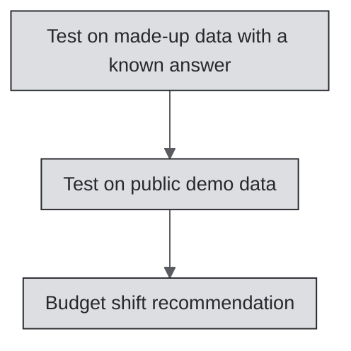

# Austrian MMM and Budget Optimizer


[](LICENSE)
[](pyproject.toml)
[](https://github.com/RafaelBraga-Kribitz/austrian-mmm-budget-optimizer/actions)
[](#status)

**Status:** Complete

- **Who decides:** the head of marketing or the CFO.
- **What they choose:** where to move the next euro of media budget.
{{#if dd}}
- **Answer:** {{answer_text}}
{{#else}}
- **Answer:** not available yet, because the budget shift recommendation has not run.
{{#endif}}
{{#if r}}
- **Main caveat:** the numbers come from a public demo file, not Austrian client data, and the demo amounts are not euros.
- **Chart:** the share of revenue each channel drives, below.
{{#elif p}}
- **Main caveat:** the numbers come from made-up data, not from Austrian client data.
- **Chart:** how well the model recovers known response curves, below.
{{#else}}
- **Main caveat:** no results exist yet.
{{#endif}}

{{#if p_or_r}}


{{headline_caption}}

{{#endif}}
## What it does

A marketing mix model (MMM) splits weekly revenue into a baseline and the part that each marketing channel caused. This repository builds one for a single advertiser.

The model is Bayesian. Each estimate comes with a 90 percent interval, not a single number.

The model answers three questions. Which channels contributed incrementally? How far off were the platform-reported numbers? What does a reallocation of the same budget gain?

Incremental revenue is revenue that would not have arrived without the channel's spend. Three steps build the answer:

1. The test on made-up data with a known answer checks that the model recovers a truth it was handed.
2. The test on public demo data fits the model on a public file.
3. The budget shift recommendation turns the fit into a decision under a breakeven rule.

{{#if r}}
**Which channels contributed?** On the public demo data, the share of revenue that each channel drives is:

{{share_table}}

{{#else}}
**Which channels contributed?** Not available yet: the test on public demo data has not run.

{{#endif}}
{{#if p}}
**How far off was the platform report?** On made-up data with a known truth, the platform report credits Paid Search with {{p_search_over}} percent more revenue than it really adds. It gives the offline channels nothing.

**Does the model recover the truth?** On that made-up data, the estimated response curves cover the true curves on {{p_curve_cov}} percent of the observed spend range. A response curve shows the revenue that a channel adds at each weekly spend level. {{p_covered}} of {{p_total}} true parameters fall inside their 90 percent intervals.

{{#else}}
**How far off was the platform report? Does the model recover the truth?** Not available yet: the test on made-up data has not run.

{{#endif}}
{{#if dd}}
**What does a reallocation gain?** On the public demo data, with the same total budget, the median gain is {{a_gain_median}} percent of current media contribution. The recommendation is in the Decision section. Units are not euros.

{{#else}}
**What does a reallocation gain?** Not available yet: the budget shift recommendation has not run.

{{#endif}}
The word "Austrian" names the setting the model is built for, not the data behind it. The setting has the Austrian public-holiday calendar as a control, weekly grain, and euro and contribution-margin logic for an Austrian advertiser. The model is validated on made-up data with a known truth and demonstrated on public data, pending a client swap-in. No Austrian client data was used.

## Start here

| Audience | Start here |
|---|---|
| Recruiter | [Decision](#decision), the first chart and the [Dashboard](#dashboard) |
| Hiring manager | [Decision](#decision), [How it works](#how-it-works) and [Validation](#validation) |
| Technical reviewer | [How it fits together](#how-it-fits-together), [How to run](#how-to-run) and `src/ambo/` |
| Auditor | [Data](#data), [Validation](#validation) and [Known limits](#known-limits) |

## Decision

{{#if dd}}
{{decision_lead}}

The expected gain is a median {{a_gain_median}} percent of current media contribution. The 10th percentile is {{a_gain_p10}} percent. The probability of a loss is {{a_p_neg}} percent across {{a_draws}} posterior draws. Units are not euros, so the recommendation is stated in percent.

A posterior draw is one plausible set of model values that fits the data. In nine of ten draws, the gain is at least the 10th percentile.

Return on ad spend (ROAS) is revenue per unit of spend. Marginal ROAS is the revenue that the next unit of spend returns. Spend and contribution are weekly, in the dataset's money units, which are not euros.

{{decision_table}}

All amounts in the table are in the demo file's money units. Units are not euros.

Gain from the reallocation: median {{d_gain_med2}} percent of current media contribution, 10th percentile {{d_gain_p10_2}} percent, probability of a loss {{d_p_neg}} percent. Units are not euros. {{decision_verdict}}

Decision rule: shift budget toward a channel only while the lower bound of its marginal ROAS 90 percent interval stays above the breakeven ROAS. Also require that the 10th percentile of the reallocation gain is positive.

{{gate_paragraph}}

{{extra_budget_paragraph}}

{{gain_caption}}

Reconsider this recommendation if the real contribution margin is lower than the assumed one. Breakeven ROAS is 1 divided by the margin, so a lower margin raises the bar that every channel must clear. It can close the gate on a channel that the rule now lets grow.

Reconsider it also if a lift test measures an incremental effect outside the model's interval for that channel. A lift test is a geo experiment or a channel holdout.

{{#else}}
Not available yet: the budget shift recommendation has not run.

{{#endif}}
## Results

{{holdout_section}}

## Validation

{{proof_section}}
{{#if p}}

The Results section shows holdout MAPE and interval coverage against two baselines. The code writes the sampler checks to `diagnostics.json` next to every fit.
{{#endif}}

## Dashboard

Four pages show the CSV feed in `reports/exports/`. The dashboard is built twice from the same files. The first build is a Power BI Project (`dashboards/MMM.pbip`): a model and a report kept as text files (TMDL and PBIR), so a test checks every visual against the model. The second build is a static HTML twin (`dashboards/html/index.html`): one file that works offline.

The screenshots below show the HTML twin. Power BI screenshots follow after the Desktop step in [dashboards/README.md](dashboards/README.md). The page specification is [docs/dashboard_handoff.md](docs/dashboard_handoff.md). The page subtitles are in German.


*Recommendation page, where the next euro goes. Pick a scenario, read the gain and the verdict of the rule, then see which channels gain budget and which the breakeven gate holds. Units are not euros.*


*Contributions page, what each channel contributes. It shows the weekly decomposition with observed revenue on top. It also shows ROAS and revenue share per channel with their intervals. Units are not euros.*


*Response curves page, where each channel levels off. It shows where each channel sits on its curve today. It also shows where the curve leaves the observed spend range.*


*Proof page, the test on known truth. It shows the same model on the made-up advertiser, judged against the disclosed truth.*

## Data

Weekly spend per channel and revenue. No Austrian client data was used.

{{data_table}}
{{#if r}}

The amounts in the public demo data are not euros. Shares, ROAS ratios and the breakeven test stay meaningful. The amounts do not. A real-data swap-in is planned.
{{#endif}}

## Known limits

{{limitations}}

[LIMITATIONS.md](LIMITATIONS.md) lists every limit and what each one means for a client engagement. The decisions behind the build are in [docs/adr/](docs/adr/README.md). The dashboard specification is in [docs/dashboard_handoff.md](docs/dashboard_handoff.md) and its build is in [dashboards/README.md](dashboards/README.md).

## What I would do differently with production data

- Geo-level weekly data, so that regional variation in spend identifies the response curves, not time alone.
- Calibration against lift tests: geo experiments or holdouts on at least one channel, used as priors or as a check on the incremental estimates.
- Media cost inflation, so that spend converts to reach before modelling and a price rise does not look like saturation.
- Competitor spend as a control, since a rival's campaign moves the baseline.
- Longer history for seasonality: three full years at minimum, with the calendar of promotions written down, not reconstructed.
- Data-quality gates before modelling: gapless weeks, spend reconciled to invoices, platform exports reconciled to the ad accounts, and outliers explained before they enter the fit.

## Why this project

Contribution profit is the north star, not revenue. A channel that returns less than the breakeven return on ad spend destroys margin, however large its revenue looks.

Customer acquisition cost must be fully loaded, or it is fiction. Attribution is a hypothesis until a test outside the platform's own reporting checks it.

Platform-reported numbers are claims, not measurements. Every platform counts the conversions it can see. It credits itself for demand that would have arrived anyway. The model in this repository tests those claims.

## How it works

The sections above use a few modelling terms. This section defines each one once.

{{method_bullets}}

## How it fits together



The test on made-up data is the validation instrument. It uses a disclosed data-generating process that the sampler must recover before anyone treats the public-demo numbers as a decision. The test on public demo data fits the same model on Robyn's public demo file. The budget shift recommendation takes the posterior of that fit and reallocates spend under the breakeven rule.

| Piece | Role |
|---|---|
| PyMC and nutpie | Bayesian MMM, NUTS sampling |
| uv | Locked install and run |
| bk-viz | Chart theme |

## How to run

```bash
uv sync
uv run pytest -m "not slow"
uv run python -m ambo.run layer_p
uv run python -m ambo.run layer_r && uv run python -m ambo.run layer_d
uv run python scripts/render_readme.py
```

A renderer builds this README from `scripts/readme_template.md` and reads every number from `reports/`. The three run commands regenerate those artifacts. The test `tests/test_readme_numbers.py` fails when the committed README, memo or German summary no longer match what the renderers produce.

## Repository structure

| Path | Responsibility |
|---|---|
| `src/ambo/` | Model, sampler, optimiser, charts, configs |
| `data/` | Made-up advertiser and public demo file |
| `reports/` | Artifacts of the three steps; the README is rendered from them |
| `scripts/` | README, memo and German summary renderers, notebook builder, dashboard export, HTML twin builder, PBIP schema check |
| `dashboards/` | Power BI Project (TMDL model, PBIR report) and the static HTML twin of the dashboard |
| `tests/` | Recovery, transforms, optimiser, the README-numbers gate, and the dashboard model-report checks |
| `docs/` | Specs, ADRs, dashboard handoff, build log |
| `notebooks/` | Walkthrough notebook |

### Legend: short names in files and charts

Folder names, run commands and chart footers use short names. This README uses the plain names.

| Short name | Plain name used in this README |
|---|---|
| `layer_p`, Layer P | Test on made-up data with a known answer |
| `layer_r`, Layer R | Test on public demo data |
| `layer_d`, Layer D | Budget shift recommendation |

## Status

**Status:** Complete

{{status_line}}

## License

MIT License. See [LICENSE](LICENSE).

## Author

<table>
  <tr>
    <td width="110">
      
    </td>
    <td>
      <strong>Rafael Braga-Kribitz</strong><br />
      Seiersberg-Pirka, Austria · Portfolio project, 2026<br />
      <a href="https://www.linkedin.com/in/rafaelbragakribitz/">LinkedIn</a>
      ·
      <a href="mailto:rafaelbragakribitz@gmail.com">rafaelbragakribitz@gmail.com</a>
    </td>
  </tr>
</table>
